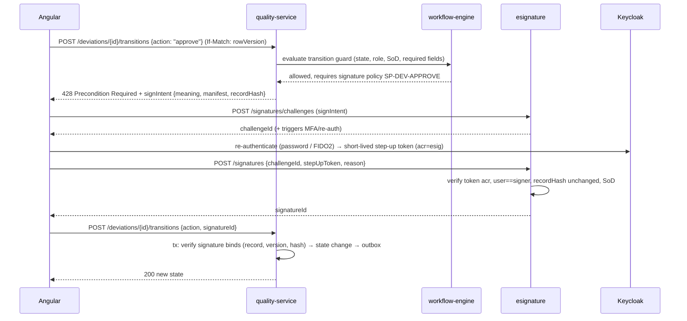

# 2. Application Architecture

## 2.1 Architectural style

**Domain-oriented services on a shared, schema-partitioned database. Event-driven where possible,
synchronous where a GxP interlock requires it.**

| Concern | Decision | Why |
|---|---|---|
| Decomposition | ~20 deployables aligned to bounded contexts (below), not one per sub-module | Each service owns a coherent transactional boundary; fewer distributed transactions in GxP flows |
| Data ownership | One PostgreSQL cluster; **schema per context**; each service's DB role has write grants only on its own schemas; cross-schema reads via read-only views or APIs | Keeps referential integrity (927 FKs) across contexts. A dangling reference in GxP is a data-integrity defect |
| Consistency | Local ACID inside a service; **transactional outbox → RabbitMQ** across services; sagas for multi-service processes | No dual writes |
| Interlocks | Synchronous query for safety checks (e.g. "is lot Released?" or "is operator trained?") | An event-driven eventual check is not acceptable for a GMP interlock |
| Extensibility | Metadata-driven (doc 10). Configured fields go in `ext jsonb`, validated against `meta.field_definition` | No per-customer DDL |
| Multi-tenancy | Shared schema with `tenant_id` and Postgres RLS (proven by OQ-DI-006). Dedicated-cluster option for large tenants | One code path for both |

> **Trade-off stated plainly:** the shared database couples schema migrations across services. This is
> mitigated by a single migration pipeline with expand/contract migrations (doc 18). If a context ever has
> to be split out, its cross-schema FKs are replaced by outbox-fed reference tables. The catalog marks
> every such FK, so the cost of a split is known in advance (doc 04, "cross-domain references").

## 2.2 Logical view

```
┌───────────────────────────────────── Clients ─────────────────────────────────────┐
│ Angular SPA (desktop) │ Angular PWA (shop-floor tablets, scanners) │ Partner portal  │
└──────────────┬──────────────────────────────┬──────────────────────────────┬──────┘
               │ OIDC (Keycloak)              │                              │
        ┌──────▼──────────────────────────────▼──────────────────────────────▼──────┐
        │ API Gateway (YARP): authN, rate limit, versioning, tenant resolution, WAF   │
        └──────┬───────────────────────────────────────────────────────────────────┘
               │ REST/JSON (+ SignalR for live MES/task updates)
┌──────────────▼──────────────────── Platform services ─────────────────────────────┐
│ identity-access │ config-studio │ workflow-engine │ esignature │ audit │ notification │
│ document │ search-indexer │ reporting │ rendering-worker │ integration-hub          │
└──────────────┬────────────────────────────────────────────────────────────────────┘
┌──────────────▼──────────────────── Domain services ───────────────────────────────┐
│ quality (qms, qrm, sqm, aud) │ training │ validation │ master-data │ erp            │
│ mes (mes, eqp) │ warehouse │ lims │ regulatory                                      │
└──────────────┬────────────────────────────────────────────────────────────────────┘
               │ outbox → RabbitMQ (topic exchanges per context) → consumers / indexer
┌──────────────▼─────────────── Data & infrastructure ──────────────────────────────┐
│ PostgreSQL 16 (CloudNativePG) │ Elasticsearch/OpenSearch │ Redis/Valkey │ RabbitMQ    │
│ MinIO (WORM buckets) │ Keycloak │ Power BI Embedded (non-GxP analytics only)         │
└──────────────┬────────────────────────────────────────────────────────────────────┘
┌──────────────▼──────────── Plant edge (per site, DMZ/Level 3.5) ──────────────────┐
│ edge-connector: OPC UA client, balance/printer drivers, store-and-forward queue     │
└──────────────────────────────────────────────────────────────────────────────────┘
```

## 2.3 Service catalogue

| Service | Owns schemas | Key responsibilities | Scales on |
|---|---|---|---|
| `gateway` | — | Routing, JWT validation, rate limits, API versions, correlation IDs | RPS |
| `identity-access` | `iam`, `org` | User provisioning from IdP (SCIM/LDAP sync), roles, ABAC policy evaluation (PDP), SoD, access reviews | Policy evals |
| `config-studio` | `meta`, `notif` (config), `rpt` (definitions) | Builders, config packages, promotion, runtime metadata API (cached in Redis) | Low |
| `workflow-engine` | `wf` | BPMN-subset execution, tasks, timers, escalations, SLA | Tasks/timers |
| `esignature` | `esig` | Challenge/response re-authentication, manifest rendering, signature binding (record hash) | Burst at release |
| `audit` | `audit` | Audit-trail query, review workflows, sealing job, export (PDF/CSV), integrity verification | Read volume |
| `notification` | `notif` (runtime) | Rules → email, in-app, Teams/Slack webhooks, digests | Events |
| `document` | `dms`, `file` | Document lifecycle, check-in/out, renditions, controlled print, logbooks | Storage I/O |
| `quality` | `qms`, `qrm`, `sqm`, `aud` | Deviations, CAPA, CC, complaints, OOS/OOT, recalls, risk, supplier quality, audits | Moderate |
| `training` | `trn` | Curricula, assignments, assessments, training gate API | Assignment bursts after effectiveness |
| `validation` | `val` | System inventory, protocols, execution, RTM, platform release packages | Low |
| `master-data` | `mdm` | Materials, products, BOMs, UoM, governance requests | Read-heavy (cache) |
| `erp` | `erp` | P2P, planning (MPS/MRP), production orders, deliveries, returns, finance hand-off | MRP batch |
| `mes` | `mes`, `eqp` | Recipes, EBR execution, dispensing, equipment status, review/release | Shop-floor concurrency |
| `warehouse` | `wms` | Lots, inventory, picking, genealogy, labels, counts | Transactions |
| `lims` | `lims` | Samples, tests, results, stability, EM, CoA, instrument integration | Result entry |
| `regulatory` | `rim` | MAs, submissions, variations, commitments, artwork, labeling | Low |
| `reporting` | `rpt` (runtime) | GxP report rendering (deterministic), dashboard data API, Power BI embed tokens | Report jobs |
| `rendering-worker` | — | PDF/A renditions, watermarking, controlled-copy stamping | CPU |
| `search-indexer` | — | Consumes outbox events and maintains search indices with ACL fields | Events |
| `integration-hub` | `intg` | External connectors, mappings, inbound/outbound, migration loaders | Integration load |
| `edge-connector` (on-prem) | local SQLite queue | OPC UA, scales, label printers, store-and-forward | Per site |

## 2.4 Cross-cutting building blocks (shared NuGet packages, `src/BuildingBlocks`)

| Block | Responsibility |
|---|---|
| `PharmaOS.Gxp.Context` | Per-request `GxpContext` (tenant, user, on-behalf-of, reason, correlation). A DB interceptor issues `SET LOCAL app.*` on every transaction |
| `PharmaOS.Gxp.Records` | Base aggregate with `RowVersion`, `Ext`, lifecycle state, `SnapshotForSignature()` → canonical JSON + SHA-256 |
| `PharmaOS.Outbox` | EF Core outbox, publisher hosted service, inbox de-duplication |
| `PharmaOS.Metadata.Client` | Cached access to entity, field, form, and rule definitions; JSON Schema validation of `ext` |
| `PharmaOS.Rules` | JSON-Logic-style AST evaluator plus DMN-style decision tables. **No embedded scripting languages** (no injection surface; statically analysable) |
| `PharmaOS.Workflow.Client` | Start, signal, and complete tasks; transition guards |
| `PharmaOS.ESig.Client` | Sign-intent → challenge → verify → bind |
| `PharmaOS.Authorization` | Permission plus ABAC policy enforcement point (PEP); row filters for queries |
| `PharmaOS.Numbering` | Gap-aware numbering via `meta.numbering_sequence` with `SELECT … FOR UPDATE` |
| `PharmaOS.Observability` | OpenTelemetry traces, metrics, structured logs (no GxP data in logs) |

## 2.5 Key interaction patterns

### 2.5.1 GxP state transition with electronic signature



If the record commit fails after the signature was created, the signature remains as an **unbound** row. A
reconciliation job marks it `VOID_UNBOUND`. It is not deleted: it is evidence of an attempt.

### 2.5.2 Saga: batch release

`mes` → requests checks from `quality` (open deviations/CAPA on batch), `lims` (all results approved, OOS closed),
`regulatory` (registered-detail conformance for market), `warehouse` (reconciliation complete),
`training` (all performers trained at time of execution) → aggregates in `mes.batch_release_check`
→ QP signature → event `BatchReleased` → `warehouse` sets lot status (idempotent consumer).

### 2.5.3 Interlocks (synchronous, fail-closed)

| Interlock | Called by | Callee | Failure mode |
|---|---|---|---|
| Lot is Released and in date | mes (dispense) | warehouse | Block + exception |
| Operator trained on effective SOP version | mes, lims | training | Block (configurable to warn only for non-GxP steps) |
| Equipment Clean, Calibrated, Qualified, and not in hold-time breach | mes, lims | mes (eqp) | Block |
| Supplier/material on ASL | erp (PO), warehouse (GR) | quality (sqm) | Block or conditional-approval path |
| Instrument calibration in date | lims | mes (eqp) | Block |

If the callee is unavailable, the interlock **fails closed**. The UI shows "verification unavailable". It never
silently allows the action.

## 2.6 Reporting split

| Class | Engine | Examples | Validation |
|---|---|---|---|
| **GxP-controlled** | In-platform `reporting` service: versioned template, deterministic render, PDF/A, output hash stored in `rpt.report_execution` | EBR, CoA, deviation report, audit-trail report, training record, PQR | Validated as part of platform |
| **Operational** | Dashboard builder (ECharts) on the platform data API | Work queues, overdue lists, KPIs | Verified (low risk) |
| **Analytical** | Power BI Embedded on a read replica / lakehouse export | Trends, cross-site benchmarking | Not used for GxP decisions; labelled "Not for GxP decision" |

## 2.7 Frontend architecture (Angular)

- Nx monorepo. Angular 18+ standalone components, signals, and OnPush everywhere.
- **Metadata renderer**: one generic record page, list page, and task page renders any entity from `meta.form_definition`.
  Dynamic forms use a schema-driven form library (e.g. ngx-formly) wrapped in a `pharmaos-field` component set.
  Hand-coded screens exist only where the UX is specialised (EBR execution, weighing, fishbone canvas,
  workflow designer, dashboard designer).
- Design system: tokens plus an accessible component library (WCAG 2.1 AA target). There is a shop-floor
  variant with 48px touch targets, glove mode, and high contrast.
- State: signals and a light store per feature. Server state uses query caching with ETag revalidation.
- Offline: **only** the shop-floor PWA, and only for read (work instructions). GxP data capture requires
  connectivity, because offline e-signatures and contemporaneous-capture guarantees are not worth the
  validation risk. The edge-connector buffers machine data, not human entries.
- i18n: runtime translations from `meta.localization_resource`. Dates are rendered in site time zone with the UTC
  offset shown on GxP records.

## 2.8 Search

Indices are built per tenant and per entity family (`{tenant}-qms-*`, `{tenant}-dms-*`). Documents carry ACL
attributes (site path, confidentiality, owner, role scopes). The gateway injects ACL filters derived from the
caller's ABAC attributes. Full-text covers document renditions (extracted text), titles, and descriptions.
Search is never a system of record: every hit is re-authorised on open.

## 2.9 Non-functional targets

| Attribute | Target |
|---|---|
| Availability (prod) | 99.9% monthly for core; MES shop-floor path 99.95% with edge buffering |
| UI response | p95 < 1.5 s for record open; p95 < 300 ms for MES step confirm |
| Throughput (reference large tenant) | 25 sites, 8 000 named users, 1 500 concurrent, 400 batches/day, 2 M audit rows/day |
| RPO / RTO | 5 min / 4 h (doc 16) |
| Audit-trail retention | Configurable per record class; default ≥ record retention (often product expiry + years; verify per market) |
| Accessibility | WCAG 2.1 AA |
| Localisation | UTF-8 throughout; RTL-capable layouts |
