# 4. Detailed ERD

> GENERATED by `tools/schema_gen.py` from `database/model/catalog.dsl` — do not edit by hand.

**447 business entities + 37 version tables + 4 audit tables = 488 physical tables** across 23 bounded-context schemas, 927 foreign keys.

## Conventions (apply to every entity, omitted from diagrams for legibility)

| Column | Purpose |
|---|---|
| `id uuid PK` | Surrogate key (app generates UUIDv7 for index locality; DB default is v4 fallback) |
| `tenant_id uuid` | Row-level security boundary |
| `site_id uuid` | Present on site-scoped (`S`) entities; drives ABAC |
| `workflow_instance_id`, `workflow_state` | Present on workflow-enabled (`W`) entities |
| `current_version_no` + `<table>_version` | Present on versioned (`V`) entities; snapshot is immutable |
| `ext jsonb` | Admin-configured fields from the Field Builder (validated against `meta.field_definition`) |
| `row_version` | Optimistic concurrency token |
| `created_at/by`, `updated_at/by` | Stamps; full history lives in `audit.audit_trail` |

Edges to `iam.app_user` and `org.site` are omitted from diagrams (nearly every entity has them).

## Context map (schemas and cross-schema FK counts)

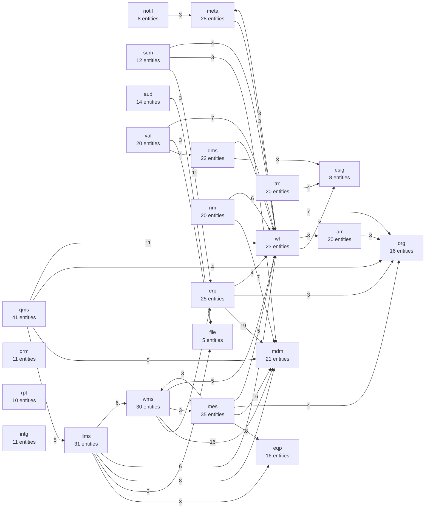

_Only schema pairs with ≥3 FKs are drawn; full list in the per-schema tables below._

## `org` — Organization & multi-site hierarchy

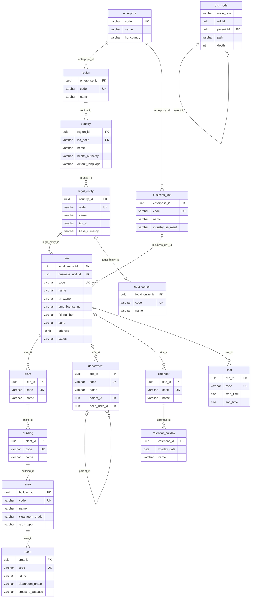

## `iam` — Identity, access, RBAC + ABAC

```mermaid
erDiagram
  app_user {
    varchar username UK
    varchar display_name
    varchar email
    varchar employee_no
    varchar idp_subject
    uuid home_site_id FK
    uuid department_id FK
    uuid manager_id FK
    varchar job_title
    varchar status
    timestamptz locked_at
    timestamptz last_login_at
    bool esig_enabled
  }
  user_identity_link {
    uuid user_id FK
    varchar provider
    varchar external_id
  }
  role {
    varchar code UK
    varchar name
    varchar description
    varchar role_type
    bool is_gxp
  }
  permission {
    varchar code UK
    varchar resource
    varchar action
    varchar description
  }
  role_permission {
    uuid role_id FK
    uuid permission_id FK
  }
  user_role_assignment {
    uuid user_id FK
    uuid role_id FK
    uuid org_node_id FK
    timestamptz valid_from
    timestamptz valid_to
    uuid granted_by FK
    varchar justification
  }
  user_group {
    varchar code UK
    varchar name
  }
  user_group_member {
    uuid group_id FK
    uuid user_id FK
  }
  group_role_assignment {
    uuid group_id FK
    uuid role_id FK
    uuid org_node_id FK
  }
  abac_policy {
    varchar code UK
    varchar name
    varchar effect
    varchar resource
    varchar action
    text condition_expr
    int priority
  }
  abac_attribute {
    varchar code UK
    varchar source
    varchar data_type
    varchar resolver
  }
  segregation_of_duty_rule {
    varchar code UK
    varchar name
    uuid conflicting_permission_a FK
    uuid conflicting_permission_b FK
    varchar enforcement
  }
  delegation {
    uuid delegator_id FK
    uuid delegate_id FK
    jsonb scope
    timestamptz valid_from
    timestamptz valid_to
    varchar reason
  }
  access_review_campaign {
    varchar code UK
    varchar name
    date due_date
    varchar status
  }
  access_review_item {
    uuid campaign_id FK
    uuid user_role_assignment_id FK
    uuid reviewer_id FK
    varchar decision
    timestamptz decided_at
    varchar comment
  }
  session_log {
    uuid user_id FK
    varchar session_id
    varchar ip_address
    varchar user_agent
    timestamptz login_at
    timestamptz logout_at
    varchar logout_reason
  }
  login_attempt {
    varchar username
    bool success
    varchar ip_address
    timestamptz attempted_at
    varchar failure_reason
  }
  api_client {
    varchar client_id UK
    varchar name
    uuid owner_user_id FK
    jsonb scopes
    varchar status
  }
  service_account {
    varchar code UK
    varchar name
    uuid api_client_id FK
    varchar status
  }
  training_gate {
    uuid permission_id FK
    uuid curriculum_id FK
    varchar enforcement
  }
  app_user |o--o{ app_user : "manager_id"
  app_user ||--o{ user_identity_link : "user_id"
  role ||--o{ role_permission : "role_id"
  permission ||--o{ role_permission : "permission_id"
  app_user ||--o{ user_role_assignment : "user_id"
  role ||--o{ user_role_assignment : "role_id"
  app_user ||--o{ user_role_assignment : "granted_by"
  user_group ||--o{ user_group_member : "group_id"
  app_user ||--o{ user_group_member : "user_id"
  user_group ||--o{ group_role_assignment : "group_id"
  role ||--o{ group_role_assignment : "role_id"
  permission ||--o{ segregation_of_duty_rule : "conflicting_permission_a"
  permission ||--o{ segregation_of_duty_rule : "conflicting_permission_b"
  app_user ||--o{ delegation : "delegator_id"
  app_user ||--o{ delegation : "delegate_id"
  access_review_campaign ||--o{ access_review_item : "campaign_id"
  user_role_assignment ||--o{ access_review_item : "user_role_assignment_id"
  app_user ||--o{ access_review_item : "reviewer_id"
  app_user ||--o{ session_log : "user_id"
  app_user ||--o{ api_client : "owner_user_id"
  api_client |o--o{ service_account : "api_client_id"
  permission ||--o{ training_gate : "permission_id"
```

Cross-domain references:

| Entity | Column | References |
|---|---|---|
| app_user | department_id | `org.department` |
| user_role_assignment | org_node_id | `org.org_node` |
| group_role_assignment | org_node_id | `org.org_node` |
| access_review_campaign | workflow_instance_id | `wf.process_instance` |
| training_gate | curriculum_id | `trn.curriculum` |

## `meta` — Metadata-driven configuration framework (builders)

```mermaid
erDiagram
  module {
    varchar code UK
    varchar name
    bool is_enabled
  }
  entity_definition {
    uuid module_id FK
    varchar code UK
    varchar name
    varchar physical_table
    bool is_custom
    bool is_gxp
    uuid numbering_scheme_id FK
    uuid default_workflow_id FK
  }
  field_definition {
    uuid entity_definition_id FK
    varchar code
    varchar label
    varchar data_type
    bool is_required
    bool is_system
    int max_length
    int num_precision
    int num_scale
    uuid lookup_list_id FK
    uuid reference_entity_id FK
    varchar default_value
    text validation_expr
    bool is_gxp_critical
    bool is_audited
    varchar storage
  }
  lookup_list {
    varchar code UK
    varchar name
    bool is_hierarchical
  }
  lookup_value {
    uuid lookup_list_id FK
    varchar code
    varchar label
    uuid parent_id FK
    int sort_order
    bool is_active
  }
  lookup_value_translation {
    uuid lookup_value_id FK
    varchar locale
    varchar label
  }
  form_definition {
    uuid entity_definition_id FK
    varchar code UK
    varchar name
    varchar form_type
    jsonb layout
    varchar status
  }
  form_section {
    uuid form_definition_id FK
    varchar code
    varchar title
    int sort_order
    uuid visibility_rule_id FK
  }
  form_field_placement {
    uuid form_section_id FK
    uuid field_definition_id FK
    int sort_order
    int col_span
    bool is_readonly
    uuid visibility_rule_id FK
    uuid required_rule_id FK
  }
  form_state_override {
    uuid form_definition_id FK
    varchar workflow_state_code
    uuid field_definition_id FK
    varchar access
  }
  business_rule {
    varchar code UK
    varchar name
    uuid entity_definition_id FK
    varchar rule_type
    varchar trigger_event
    text expression
    varchar expression_language
    varchar severity
    varchar message
    bool is_active
  }
  business_rule_action {
    uuid business_rule_id FK
    varchar action_type
    jsonb parameters
    int sort_order
  }
  decision_table {
    varchar code UK
    varchar name
    varchar hit_policy
    jsonb inputs
    jsonb outputs
  }
  decision_table_row {
    uuid decision_table_id FK
    int row_no
    jsonb conditions
    jsonb results
  }
  numbering_scheme {
    varchar code UK
    varchar pattern
    varchar reset_policy
    bool site_scoped
  }
  numbering_sequence {
    uuid numbering_scheme_id FK
    varchar scope_key
    bigint current_value
  }
  menu {
    varchar code UK
    varchar name
    varchar app_area
  }
  menu_item {
    uuid menu_id FK
    uuid parent_id FK
    varchar label
    varchar route
    varchar icon
    uuid permission_id FK
    int sort_order
  }
  list_view_definition {
    uuid entity_definition_id FK
    varchar code UK
    varchar name
    jsonb columns
    jsonb filters
    jsonb sort_spec
    bool is_default
  }
  document_template {
    varchar code UK
    varchar name
    varchar template_type
    uuid entity_definition_id FK
    uuid stored_object_id FK
    jsonb merge_fields
  }
  email_template {
    varchar code UK
    varchar name
    varchar subject_template
    text body_template
    varchar locale
  }
  audit_policy {
    uuid entity_definition_id FK
    uuid field_definition_id FK
    varchar capture_mode
    bool reason_required
    int review_frequency_days
  }
  config_package {
    varchar code UK
    varchar name
    varchar version_label
    varchar source_environment
    hash content_hash
    jsonb manifest
    varchar status
  }
  config_package_item {
    uuid config_package_id FK
    varchar artifact_type
    uuid artifact_id
    varchar artifact_version
    jsonb payload
  }
  config_deployment {
    uuid config_package_id FK
    varchar target_environment
    timestamptz deployed_at
    uuid deployed_by FK
    varchar result
    text log
  }
  localization_resource {
    varchar locale
    varchar resource_key
    text value
  }
  feature_flag {
    varchar code UK
    varchar description
    bool is_enabled
    jsonb scope
  }
  custom_entity_record {
    uuid entity_definition_id FK
    varchar record_no
    jsonb data
    varchar status
  }
  module ||--o{ entity_definition : "module_id"
  numbering_scheme |o--o{ entity_definition : "numbering_scheme_id"
  entity_definition ||--o{ field_definition : "entity_definition_id"
  lookup_list |o--o{ field_definition : "lookup_list_id"
  entity_definition |o--o{ field_definition : "reference_entity_id"
  lookup_list ||--o{ lookup_value : "lookup_list_id"
  lookup_value |o--o{ lookup_value : "parent_id"
  lookup_value ||--o{ lookup_value_translation : "lookup_value_id"
  entity_definition ||--o{ form_definition : "entity_definition_id"
  form_definition ||--o{ form_section : "form_definition_id"
  business_rule |o--o{ form_section : "visibility_rule_id"
  form_section ||--o{ form_field_placement : "form_section_id"
  field_definition ||--o{ form_field_placement : "field_definition_id"
  business_rule |o--o{ form_field_placement : "visibility_rule_id"
  business_rule |o--o{ form_field_placement : "required_rule_id"
  form_definition ||--o{ form_state_override : "form_definition_id"
  field_definition ||--o{ form_state_override : "field_definition_id"
  entity_definition |o--o{ business_rule : "entity_definition_id"
  business_rule ||--o{ business_rule_action : "business_rule_id"
  decision_table ||--o{ decision_table_row : "decision_table_id"
  numbering_scheme ||--o{ numbering_sequence : "numbering_scheme_id"
  menu ||--o{ menu_item : "menu_id"
  menu_item |o--o{ menu_item : "parent_id"
  entity_definition ||--o{ list_view_definition : "entity_definition_id"
  entity_definition |o--o{ document_template : "entity_definition_id"
  entity_definition ||--o{ audit_policy : "entity_definition_id"
  field_definition |o--o{ audit_policy : "field_definition_id"
  config_package ||--o{ config_package_item : "config_package_id"
  config_package ||--o{ config_deployment : "config_package_id"
  entity_definition ||--o{ custom_entity_record : "entity_definition_id"
```

Cross-domain references:

| Entity | Column | References |
|---|---|---|
| entity_definition | default_workflow_id | `wf.process_definition` |
| menu_item | permission_id | `iam.permission` |
| document_template | stored_object_id | `file.stored_object` |
| config_package | workflow_instance_id | `wf.process_instance` |
| custom_entity_record | workflow_instance_id | `wf.process_instance` |

## `wf` — BPMN workflow engine

```mermaid
erDiagram
  process_definition {
    varchar code UK
    varchar name
    uuid entity_definition_id FK
    text bpmn_xml
    jsonb model_json
    varchar status
    bool is_gxp
  }
  process_node {
    uuid process_definition_id FK
    varchar node_key
    varchar node_type
    varchar name
    jsonb config
  }
  process_transition {
    uuid process_definition_id FK
    uuid from_node_id FK
    uuid to_node_id FK
    text condition_expr
    bool requires_esig
    uuid esig_meaning_id FK
    int sort_order
  }
  workflow_draft {
    varchar code
    int version_no
    varchar initial_state
    jsonb transitions
    varchar status
    jsonb validation_errors
  }
  approval_route_template {
    varchar code UK
    varchar name
    varchar mode
    int quorum
    jsonb config
  }
  approval_route_step {
    uuid route_template_id FK
    int step_no
    varchar mode
    jsonb assignee_rule
    int min_approvals
    interval due_in
    uuid esig_meaning_id FK
  }
  process_instance {
    uuid process_definition_id FK
    varchar definition_version
    uuid entity_definition_id FK
    varchar business_key
    uuid record_id
    varchar status
    timestamptz started_at
    timestamptz completed_at
    uuid started_by FK
  }
  token {
    uuid process_instance_id FK
    uuid node_id FK
    uuid parent_token_id FK
    varchar status
    timestamptz arrived_at
  }
  task {
    uuid process_instance_id FK
    uuid node_id FK
    uuid token_id FK
    varchar name
    varchar status
    varchar priority
    timestamptz due_at
    uuid claimed_by FK
    uuid completed_by FK
    timestamptz completed_at
    varchar outcome
  }
  task_candidate {
    uuid task_id FK
    varchar candidate_type
    uuid user_id FK
    uuid role_id FK
    uuid group_id FK
  }
  task_comment {
    uuid task_id FK
    uuid author_id FK
    text body
  }
  task_delegation {
    uuid task_id FK
    uuid from_user_id FK
    uuid to_user_id FK
    varchar reason
    uuid delegation_id FK
  }
  escalation_policy {
    varchar code UK
    varchar name
    jsonb levels
  }
  escalation_event {
    uuid task_id FK
    uuid escalation_policy_id FK
    int level
    timestamptz fired_at
    jsonb notified
  }
  timer_job {
    uuid process_instance_id FK
    uuid task_id FK
    timestamptz fire_at
    varchar job_type
    jsonb payload
    varchar status
    int attempts
  }
  process_variable {
    uuid process_instance_id FK
    varchar name
    jsonb value
  }
  process_history {
    uuid process_instance_id FK
    varchar from_node_key
    varchar to_node_key
    uuid transition_id FK
    uuid actor_id FK
    timestamptz occurred_at
    varchar comment
    uuid signature_id FK
  }
  rejection_loop_counter {
    uuid process_instance_id FK
    varchar node_key
    int loop_count
  }
  sla_definition {
    varchar code UK
    uuid entity_definition_id FK
    interval target_duration
    int warning_at_pct
    uuid business_calendar_id FK
  }
  sla_tracking {
    uuid sla_definition_id FK
    uuid process_instance_id FK
    timestamptz due_at
    bool breached
    timestamptz breached_at
  }
  external_event_subscription {
    uuid process_instance_id FK
    varchar event_type
    varchar correlation_key
    varchar status
  }
  user_out_of_office {
    uuid user_id FK
    timestamptz start_at
    timestamptz end_at
    uuid delegate_id FK
  }
  workflow_simulation_run {
    uuid process_definition_id FK
    jsonb scenario
    jsonb result
    timestamptz executed_at
  }
  process_definition ||--o{ process_node : "process_definition_id"
  process_definition ||--o{ process_transition : "process_definition_id"
  process_node ||--o{ process_transition : "from_node_id"
  process_node ||--o{ process_transition : "to_node_id"
  approval_route_template ||--o{ approval_route_step : "route_template_id"
  process_definition ||--o{ process_instance : "process_definition_id"
  process_instance ||--o{ token : "process_instance_id"
  process_node ||--o{ token : "node_id"
  token |o--o{ token : "parent_token_id"
  process_instance ||--o{ task : "process_instance_id"
  process_node ||--o{ task : "node_id"
  token |o--o{ task : "token_id"
  task ||--o{ task_candidate : "task_id"
  task ||--o{ task_comment : "task_id"
  task ||--o{ task_delegation : "task_id"
  task ||--o{ escalation_event : "task_id"
  escalation_policy ||--o{ escalation_event : "escalation_policy_id"
  process_instance |o--o{ timer_job : "process_instance_id"
  task |o--o{ timer_job : "task_id"
  process_instance ||--o{ process_variable : "process_instance_id"
  process_instance ||--o{ process_history : "process_instance_id"
  process_transition |o--o{ process_history : "transition_id"
  process_instance ||--o{ rejection_loop_counter : "process_instance_id"
  sla_definition ||--o{ sla_tracking : "sla_definition_id"
  process_instance ||--o{ sla_tracking : "process_instance_id"
  process_instance ||--o{ external_event_subscription : "process_instance_id"
  process_definition ||--o{ workflow_simulation_run : "process_definition_id"
```

Cross-domain references:

| Entity | Column | References |
|---|---|---|
| process_definition | entity_definition_id | `meta.entity_definition` |
| process_transition | esig_meaning_id | `esig.signature_meaning` |
| approval_route_step | esig_meaning_id | `esig.signature_meaning` |
| process_instance | entity_definition_id | `meta.entity_definition` |
| task_candidate | role_id | `iam.role` |
| task_candidate | group_id | `iam.user_group` |
| task_delegation | delegation_id | `iam.delegation` |
| process_history | signature_id | `esig.signature` |
| sla_definition | entity_definition_id | `meta.entity_definition` |
| sla_definition | business_calendar_id | `org.calendar` |

## `esig` — Electronic signatures (21 CFR Part 11 / Annex 11)

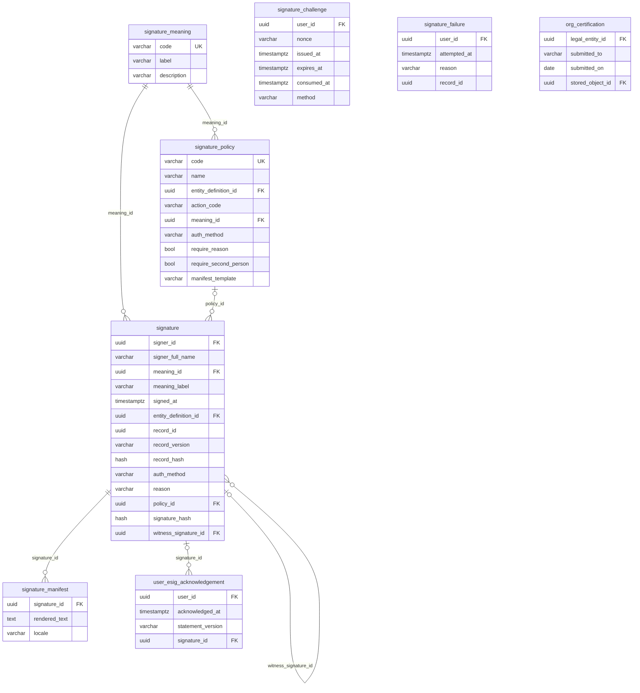

Cross-domain references:

| Entity | Column | References |
|---|---|---|
| signature_policy | entity_definition_id | `meta.entity_definition` |
| signature | entity_definition_id | `meta.entity_definition` |
| org_certification | legal_entity_id | `org.legal_entity` |
| org_certification | stored_object_id | `file.stored_object` |

## `notif` — Notification builder & delivery

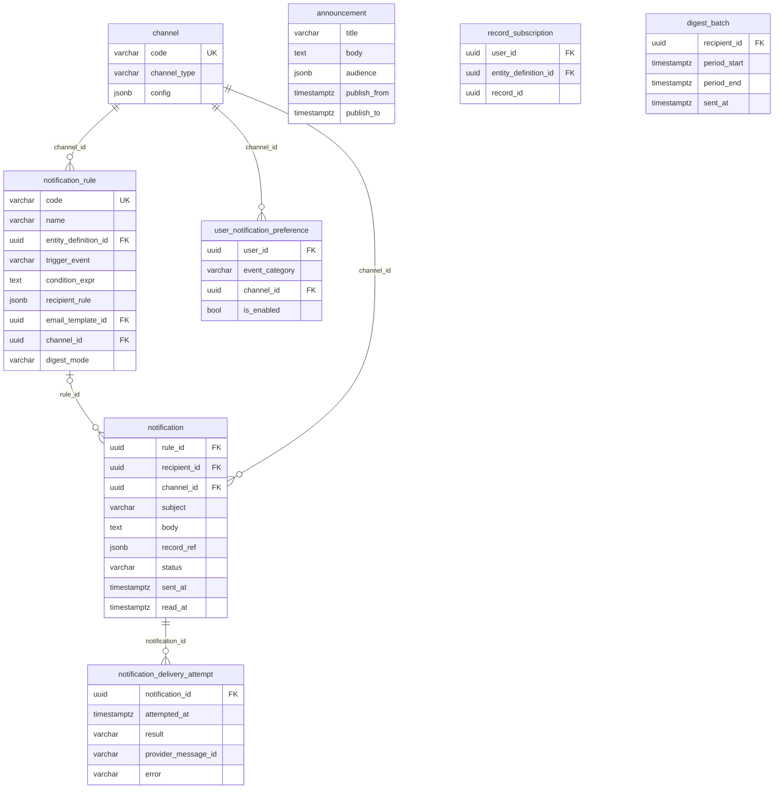

Cross-domain references:

| Entity | Column | References |
|---|---|---|
| notification_rule | entity_definition_id | `meta.entity_definition` |
| notification_rule | email_template_id | `meta.email_template` |
| record_subscription | entity_definition_id | `meta.entity_definition` |

## `file` — Object storage index (S3-compatible, self-hosted) & retention

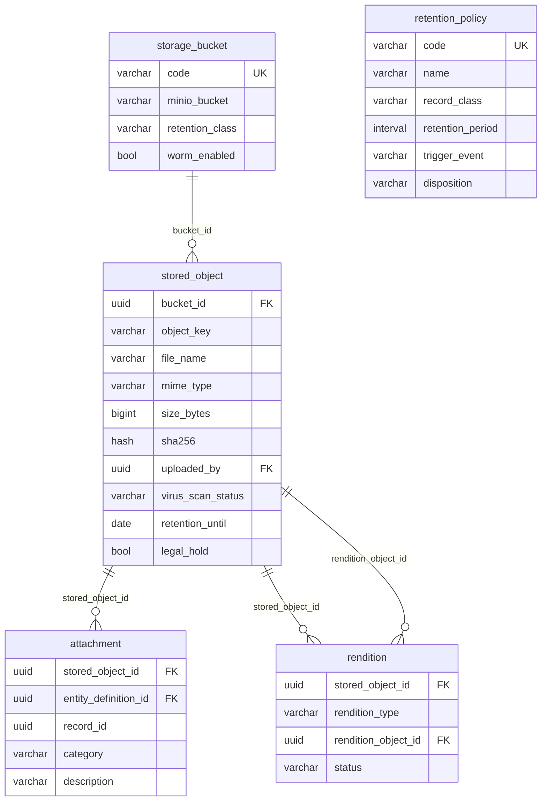

Cross-domain references:

| Entity | Column | References |
|---|---|---|
| attachment | entity_definition_id | `meta.entity_definition` |

## `dms` — Document management

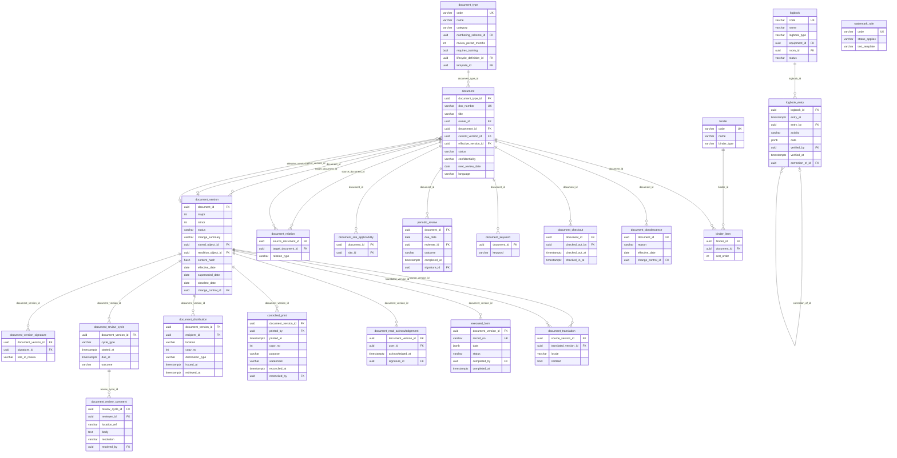

Cross-domain references:

| Entity | Column | References |
|---|---|---|
| document_type | numbering_scheme_id | `meta.numbering_scheme` |
| document_type | lifecycle_definition_id | `wf.process_definition` |
| document_type | template_id | `meta.document_template` |
| document | department_id | `org.department` |
| document | workflow_instance_id | `wf.process_instance` |
| document_version | stored_object_id | `file.stored_object` |
| document_version | rendition_object_id | `file.stored_object` |
| document_version | change_control_id | `qms.change_control` |
| document_version_signature | signature_id | `esig.signature` |
| document_review_cycle | workflow_instance_id | `wf.process_instance` |
| periodic_review | signature_id | `esig.signature` |
| periodic_review | workflow_instance_id | `wf.process_instance` |
| document_read_acknowledgement | signature_id | `esig.signature` |
| executed_form | workflow_instance_id | `wf.process_instance` |
| logbook | equipment_id | `eqp.equipment` |
| logbook | room_id | `org.room` |
| document_obsolescence | change_control_id | `qms.change_control` |

## `qms` — Quality management processes

```mermaid
erDiagram
  quality_event {
    varchar event_no UK
    varchar event_type
    varchar title
    text description
    uuid reported_by FK
    timestamptz reported_at
    timestamptz occurred_at
    uuid area_id FK
    varchar triage_outcome
    varchar status
  }
  deviation {
    varchar deviation_no UK
    uuid quality_event_id FK
    varchar title
    text description
    varchar classification
    varchar deviation_type
    bool is_planned
    timestamptz occurred_at
    timestamptz discovered_at
    uuid area_id FK
    uuid product_id FK
    text immediate_action
    text impact_assessment
    text root_cause_summary
    int risk_score
    uuid owner_id FK
    uuid qa_owner_id FK
    date due_date
    timestamptz closed_at
    varchar status
    bool recurrence_flag
  }
  deviation_batch {
    uuid deviation_id FK
    uuid batch_id FK
    varchar impact
  }
  deviation_material {
    uuid deviation_id FK
    uuid material_id FK
    uuid lot_id FK
  }
  deviation_equipment {
    uuid deviation_id FK
    uuid equipment_id FK
  }
  due_date_extension {
    varchar source_type
    uuid source_id
    date current_due_date
    date requested_due_date
    varchar justification
    uuid approved_signature_id FK
    varchar status
  }
  investigation {
    varchar source_type
    uuid source_id
    varchar investigation_no UK
    uuid lead_id FK
    varchar method
    text scope
    text conclusion
    varchar status
  }
  rca_five_why {
    uuid investigation_id FK
    varchar problem_statement
    int why_level
    varchar question
    varchar answer
    uuid parent_id FK
  }
  rca_fishbone {
    uuid investigation_id FK
    varchar effect
    varchar model
  }
  rca_fishbone_cause {
    uuid fishbone_id FK
    varchar category
    varchar cause
    uuid parent_id FK
    bool is_root_cause
    varchar evidence
  }
  rca_is_is_not {
    uuid investigation_id FK
    varchar dimension
    varchar is_text
    varchar is_not_text
    varchar distinction
  }
  root_cause {
    uuid investigation_id FK
    varchar category
    varchar subcategory
    varchar description
    bool is_primary
  }
  capa {
    varchar capa_no UK
    varchar source_type
    uuid source_id
    varchar title
    text problem_statement
    varchar capa_type
    uuid owner_id FK
    uuid root_cause_id FK
    varchar priority
    date due_date
    varchar status
    timestamptz closed_at
  }
  capa_action {
    uuid capa_id FK
    int action_no
    varchar action_type
    text description
    uuid assignee_id FK
    date due_date
    timestamptz completed_at
    text evidence
    varchar status
    uuid change_control_id FK
  }
  capa_effectiveness_check {
    uuid capa_id FK
    text criteria
    varchar method
    date planned_date
    timestamptz performed_at
    varchar result
    text evidence
    uuid performed_by FK
  }
  capa_link {
    uuid capa_id FK
    varchar linked_type
    uuid linked_id
  }
  change_control {
    varchar cc_no UK
    varchar title
    text description
    varchar change_type
    varchar change_category
    text justification
    bool is_temporary
    date temporary_end_date
    uuid owner_id FK
    uuid risk_assessment_id FK
    varchar regulatory_impact
    date implementation_due
    date effective_date
    varchar status
  }
  change_impact_assessment {
    uuid change_control_id FK
    varchar impacted_area
    uuid assessor_id FK
    bool is_impacted
    text assessment
    text action_required
  }
  change_affected_item {
    uuid change_control_id FK
    varchar item_type
    uuid item_id
    varchar item_ref
  }
  change_task {
    uuid change_control_id FK
    int task_no
    varchar phase
    text description
    uuid assignee_id FK
    date due_date
    varchar status
    timestamptz completed_at
  }
  change_regulatory_assessment {
    uuid change_control_id FK
    uuid country_id FK
    varchar variation_category
    bool filing_required
    uuid variation_id FK
  }
  complaint {
    varchar complaint_no UK
    timestamptz received_at
    varchar channel
    varchar complainant_type
    varchar complainant_name
    uuid country_id FK
    uuid product_id FK
    varchar lot_no
    text description
    varchar category
    bool is_adverse_event
    bool is_reportable
    date reportability_due
    bool sample_requested
    timestamptz sample_received_at
    uuid owner_id FK
    varchar status
    timestamptz response_sent_at
  }
  complaint_sample {
    uuid complaint_id FK
    timestamptz received_at
    varchar sample_condition
    varchar retained_location
  }
  complaint_code {
    varchar code UK
    varchar name
    uuid parent_id FK
  }
  complaint_communication {
    uuid complaint_id FK
    varchar direction
    timestamptz sent_at
    varchar channel
    varchar summary
    uuid stored_object_id FK
  }
  pv_case_link {
    uuid complaint_id FK
    varchar safety_case_ref
    varchar safety_system
    timestamptz transferred_at
  }
  oos_investigation {
    varchar oos_no UK
    varchar kind
    uuid test_result_id FK
    uuid sample_id FK
    varchar specification_limit
    varchar reported_value
    varchar phase
    varchar phase1_conclusion
    bool assignable_cause
    bool retest_allowed
    varchar phase2_conclusion
    text batch_impact
    uuid owner_id FK
    varchar status
  }
  oos_hypothesis_test {
    uuid oos_id FK
    varchar hypothesis
    varchar test_performed
    varchar result
    bool supports_cause
  }
  oos_retest {
    uuid oos_id FK
    uuid sample_id FK
    uuid test_result_id FK
    uuid analyst_id FK
    varchar justification
  }
  oot_trend_rule {
    varchar code UK
    varchar name
    varchar method
    jsonb parameters
    uuid specification_id FK
  }
  recall {
    varchar recall_no UK
    uuid product_id FK
    varchar recall_class
    varchar depth
    text reason
    timestamptz initiated_at
    varchar status
    timestamptz authority_notified_at
  }
  recall_lot {
    uuid recall_id FK
    uuid lot_id FK
    numeric quantity_distributed
    numeric quantity_recovered
  }
  recall_customer_notice {
    uuid recall_id FK
    uuid customer_id FK
    timestamptz notified_at
    timestamptz acknowledged_at
  }
  management_review {
    varchar review_no UK
    date period_start
    date period_end
    date meeting_date
    uuid chair_id FK
    text summary
    varchar status
  }
  management_review_input {
    uuid management_review_id FK
    varchar input_type
    jsonb metric_snapshot
    text commentary
  }
  management_review_action {
    uuid management_review_id FK
    varchar description
    uuid owner_id FK
    date due_date
    uuid capa_id FK
    varchar status
  }
  quality_metric_definition {
    varchar code UK
    varchar name
    text formula
    varchar unit
    varchar direction
    numeric target
    numeric threshold_amber
    numeric threshold_red
    varchar frequency
  }
  quality_metric_value {
    uuid metric_definition_id FK
    uuid site_id FK
    date period_start
    date period_end
    numeric value
    numeric numerator
    numeric denominator
    timestamptz computed_at
  }
  product_quality_review {
    varchar pqr_no UK
    uuid product_id FK
    date period_start
    date period_end
    varchar status
    text conclusion
  }
  product_quality_review_section {
    uuid pqr_id FK
    varchar section_code
    jsonb content
    uuid author_id FK
  }
  lessons_learned {
    varchar source_type
    uuid source_id
    text summary
    jsonb applicability
  }
  quality_event |o--o{ deviation : "quality_event_id"
  deviation ||--o{ deviation_batch : "deviation_id"
  deviation ||--o{ deviation_material : "deviation_id"
  deviation ||--o{ deviation_equipment : "deviation_id"
  investigation ||--o{ rca_five_why : "investigation_id"
  rca_five_why |o--o{ rca_five_why : "parent_id"
  investigation ||--o{ rca_fishbone : "investigation_id"
  rca_fishbone ||--o{ rca_fishbone_cause : "fishbone_id"
  rca_fishbone_cause |o--o{ rca_fishbone_cause : "parent_id"
  investigation ||--o{ rca_is_is_not : "investigation_id"
  investigation ||--o{ root_cause : "investigation_id"
  root_cause |o--o{ capa : "root_cause_id"
  capa ||--o{ capa_action : "capa_id"
  change_control |o--o{ capa_action : "change_control_id"
  capa ||--o{ capa_effectiveness_check : "capa_id"
  capa ||--o{ capa_link : "capa_id"
  change_control ||--o{ change_impact_assessment : "change_control_id"
  change_control ||--o{ change_affected_item : "change_control_id"
  change_control ||--o{ change_task : "change_control_id"
  change_control ||--o{ change_regulatory_assessment : "change_control_id"
  complaint ||--o{ complaint_sample : "complaint_id"
  complaint_code |o--o{ complaint_code : "parent_id"
  complaint ||--o{ complaint_communication : "complaint_id"
  complaint ||--o{ pv_case_link : "complaint_id"
  oos_investigation ||--o{ oos_hypothesis_test : "oos_id"
  oos_investigation ||--o{ oos_retest : "oos_id"
  recall ||--o{ recall_lot : "recall_id"
  recall ||--o{ recall_customer_notice : "recall_id"
  management_review ||--o{ management_review_input : "management_review_id"
  management_review ||--o{ management_review_action : "management_review_id"
  capa |o--o{ management_review_action : "capa_id"
  quality_metric_definition ||--o{ quality_metric_value : "metric_definition_id"
  product_quality_review ||--o{ product_quality_review_section : "pqr_id"
```

Cross-domain references:

| Entity | Column | References |
|---|---|---|
| quality_event | area_id | `org.area` |
| quality_event | workflow_instance_id | `wf.process_instance` |
| deviation | area_id | `org.area` |
| deviation | product_id | `mdm.product` |
| deviation | workflow_instance_id | `wf.process_instance` |
| deviation_batch | batch_id | `mes.batch` |
| deviation_material | material_id | `mdm.material` |
| deviation_material | lot_id | `wms.lot` |
| deviation_equipment | equipment_id | `eqp.equipment` |
| due_date_extension | approved_signature_id | `esig.signature` |
| investigation | workflow_instance_id | `wf.process_instance` |
| capa | workflow_instance_id | `wf.process_instance` |
| capa_effectiveness_check | workflow_instance_id | `wf.process_instance` |
| change_control | risk_assessment_id | `qrm.risk_assessment` |
| change_control | workflow_instance_id | `wf.process_instance` |
| change_regulatory_assessment | country_id | `org.country` |
| change_regulatory_assessment | variation_id | `rim.variation` |
| complaint | country_id | `org.country` |
| complaint | product_id | `mdm.product` |
| complaint | workflow_instance_id | `wf.process_instance` |
| complaint_communication | stored_object_id | `file.stored_object` |
| oos_investigation | test_result_id | `lims.test_result` |
| oos_investigation | sample_id | `lims.sample` |
| oos_investigation | workflow_instance_id | `wf.process_instance` |
| oos_retest | sample_id | `lims.sample` |
| oos_retest | test_result_id | `lims.test_result` |
| oot_trend_rule | specification_id | `lims.specification` |
| recall | product_id | `mdm.product` |
| recall | workflow_instance_id | `wf.process_instance` |
| recall_lot | lot_id | `wms.lot` |
| recall_customer_notice | customer_id | `erp.customer` |
| management_review | workflow_instance_id | `wf.process_instance` |
| product_quality_review | product_id | `mdm.product` |
| product_quality_review | workflow_instance_id | `wf.process_instance` |

## `qrm` — Quality risk management (ICH Q9)

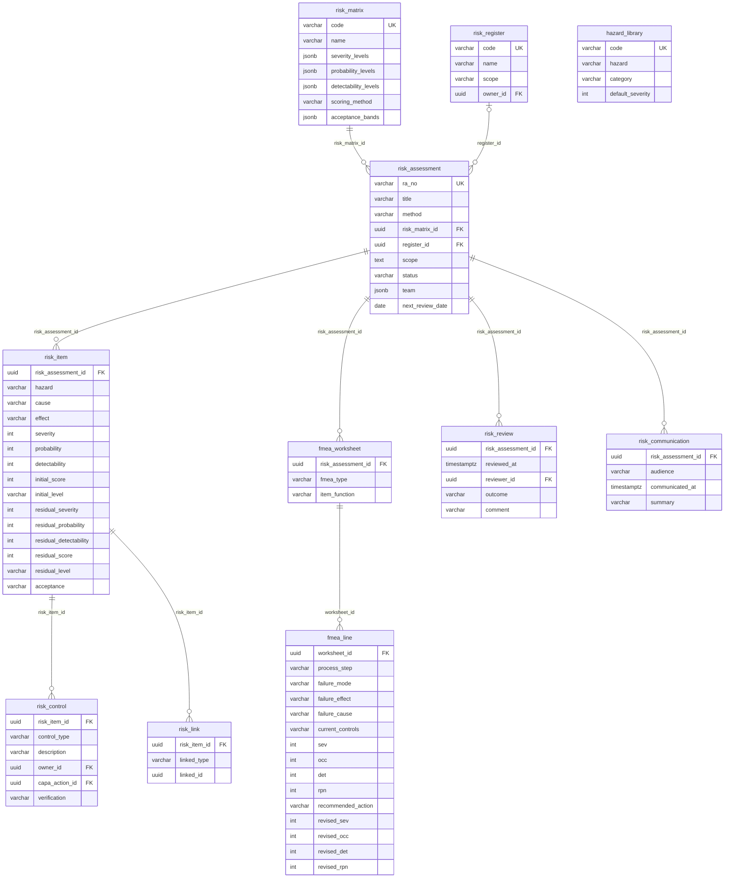

Cross-domain references:

| Entity | Column | References |
|---|---|---|
| risk_assessment | workflow_instance_id | `wf.process_instance` |
| risk_control | capa_action_id | `qms.capa_action` |

## `sqm` — Supplier quality

```mermaid
erDiagram
  supplier_site {
    uuid supplier_id FK
    varchar name
    jsonb address
    uuid country_id FK
    varchar gmp_certificate_no
    date gmp_certificate_expiry
  }
  supplier_qualification {
    uuid supplier_id FK
    uuid material_id FK
    uuid site_id FK
    varchar status
    varchar qualification_type
    varchar risk_level
    timestamptz approved_at
    date expires_at
  }
  approved_supplier_list {
    uuid supplier_id FK
    uuid manufacturer_site_id FK
    uuid material_id FK
    varchar status
    date valid_until
    varchar conditions
  }
  supplier_questionnaire {
    varchar code UK
    varchar name
    jsonb questions
  }
  supplier_questionnaire_response {
    uuid questionnaire_id FK
    uuid supplier_id FK
    jsonb responses
    timestamptz submitted_at
    numeric score
  }
  quality_agreement {
    uuid supplier_id FK
    varchar agreement_no UK
    uuid document_id FK
    date effective_date
    date expiry_date
    varchar status
  }
  supplier_scorecard {
    uuid supplier_id FK
    date period_start
    date period_end
    numeric quality_score
    numeric delivery_score
    numeric responsiveness_score
    numeric overall_score
    varchar tier
  }
  scar {
    varchar scar_no UK
    uuid supplier_id FK
    varchar source_type
    uuid source_id
    text description
    date response_due
    text supplier_response
    varchar status
  }
  supplier_change_notification {
    uuid supplier_id FK
    timestamptz received_at
    text description
    uuid change_control_id FK
    varchar assessment
    varchar status
  }
  supplier_certificate {
    uuid supplier_id FK
    varchar certificate_type
    varchar number
    varchar issued_by
    date valid_from
    date valid_to
    uuid stored_object_id FK
  }
  supplier_material_risk {
    uuid supplier_id FK
    uuid material_id FK
    uuid risk_assessment_id FK
    varchar risk_level
    varchar testing_regime
  }
  supplier_audit_schedule {
    uuid supplier_id FK
    date planned_date
    uuid audit_id FK
    int frequency_months
  }
  supplier_site |o--o{ approved_supplier_list : "manufacturer_site_id"
  supplier_questionnaire ||--o{ supplier_questionnaire_response : "questionnaire_id"
```

Cross-domain references:

| Entity | Column | References |
|---|---|---|
| supplier_site | supplier_id | `erp.supplier` |
| supplier_site | country_id | `org.country` |
| supplier_qualification | supplier_id | `erp.supplier` |
| supplier_qualification | material_id | `mdm.material` |
| supplier_qualification | workflow_instance_id | `wf.process_instance` |
| approved_supplier_list | supplier_id | `erp.supplier` |
| approved_supplier_list | material_id | `mdm.material` |
| supplier_questionnaire_response | supplier_id | `erp.supplier` |
| quality_agreement | supplier_id | `erp.supplier` |
| quality_agreement | document_id | `dms.document` |
| quality_agreement | workflow_instance_id | `wf.process_instance` |
| supplier_scorecard | supplier_id | `erp.supplier` |
| scar | supplier_id | `erp.supplier` |
| scar | workflow_instance_id | `wf.process_instance` |
| supplier_change_notification | supplier_id | `erp.supplier` |
| supplier_change_notification | change_control_id | `qms.change_control` |
| supplier_change_notification | workflow_instance_id | `wf.process_instance` |
| supplier_certificate | supplier_id | `erp.supplier` |
| supplier_certificate | stored_object_id | `file.stored_object` |
| supplier_material_risk | supplier_id | `erp.supplier` |
| supplier_material_risk | material_id | `mdm.material` |
| supplier_material_risk | risk_assessment_id | `qrm.risk_assessment` |
| supplier_audit_schedule | supplier_id | `erp.supplier` |
| supplier_audit_schedule | audit_id | `aud.audit` |

## `aud` — Audit & regulatory inspection management

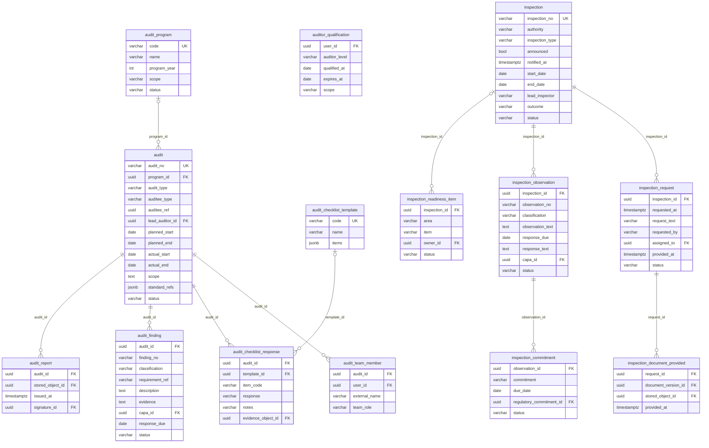

Cross-domain references:

| Entity | Column | References |
|---|---|---|
| audit | workflow_instance_id | `wf.process_instance` |
| audit_checklist_response | evidence_object_id | `file.stored_object` |
| audit_finding | capa_id | `qms.capa` |
| audit_report | stored_object_id | `file.stored_object` |
| audit_report | signature_id | `esig.signature` |
| inspection | workflow_instance_id | `wf.process_instance` |
| inspection_document_provided | document_version_id | `dms.document_version` |
| inspection_document_provided | stored_object_id | `file.stored_object` |
| inspection_observation | capa_id | `qms.capa` |
| inspection_commitment | regulatory_commitment_id | `rim.regulatory_commitment` |

## `trn` — Training management

```mermaid
erDiagram
  competency {
    varchar code UK
    varchar name
    varchar description
  }
  job_role {
    varchar code UK
    varchar name
    uuid department_id FK
  }
  job_role_competency {
    uuid job_role_id FK
    uuid competency_id FK
    int required_level
  }
  user_job_role {
    uuid user_id FK
    uuid job_role_id FK
    date assigned_from
    date assigned_to
  }
  course {
    varchar code UK
    varchar title
    varchar course_type
    uuid document_id FK
    int duration_minutes
    bool has_assessment
    numeric passing_score
    int retraining_months
    varchar status
  }
  course_material {
    uuid course_id FK
    uuid stored_object_id FK
    varchar material_type
  }
  curriculum {
    varchar code UK
    varchar name
    varchar status
  }
  curriculum_item {
    uuid curriculum_id FK
    uuid course_id FK
    bool is_mandatory
    int due_within_days
    int sort_order
  }
  job_role_curriculum {
    uuid job_role_id FK
    uuid curriculum_id FK
  }
  training_assignment {
    uuid user_id FK
    uuid course_id FK
    varchar course_version
    varchar source_type
    uuid source_id
    timestamptz assigned_at
    date due_date
    varchar status
    timestamptz completed_at
    uuid signature_id FK
  }
  training_session {
    uuid course_id FK
    uuid trainer_id FK
    timestamptz start_at
    timestamptz end_at
    varchar location
    int capacity
    varchar status
  }
  training_session_attendance {
    uuid session_id FK
    uuid user_id FK
    bool attended
    uuid trainer_signature_id FK
  }
  assessment {
    uuid course_id FK
    varchar code UK
    varchar name
    int question_pool_size
    int questions_per_attempt
  }
  assessment_question {
    uuid assessment_id FK
    varchar question_type
    text question_text
    jsonb options
    jsonb correct_answer
    numeric points
  }
  assessment_attempt {
    uuid assessment_id FK
    uuid user_id FK
    timestamptz started_at
    timestamptz submitted_at
    numeric score
    bool passed
    jsonb answers
  }
  ojt_record {
    uuid user_id FK
    uuid course_id FK
    uuid trainer_id FK
    text observations
    timestamptz performed_at
    varchar outcome
    uuid trainer_signature_id FK
  }
  trainer_qualification {
    uuid user_id FK
    uuid course_id FK
    date qualified_at
    date expires_at
  }
  external_training_record {
    uuid user_id FK
    varchar title
    varchar provider
    date completed_on
    uuid stored_object_id FK
  }
  training_matrix_snapshot {
    uuid job_role_id FK
    timestamptz snapshot_at
    jsonb data
  }
  training_waiver {
    uuid assignment_id FK
    varchar reason
    uuid approved_signature_id FK
  }
  job_role ||--o{ job_role_competency : "job_role_id"
  competency ||--o{ job_role_competency : "competency_id"
  job_role ||--o{ user_job_role : "job_role_id"
  course ||--o{ course_material : "course_id"
  curriculum ||--o{ curriculum_item : "curriculum_id"
  course ||--o{ curriculum_item : "course_id"
  job_role ||--o{ job_role_curriculum : "job_role_id"
  curriculum ||--o{ job_role_curriculum : "curriculum_id"
  course ||--o{ training_assignment : "course_id"
  course ||--o{ training_session : "course_id"
  training_session ||--o{ training_session_attendance : "session_id"
  course ||--o{ assessment : "course_id"
  assessment ||--o{ assessment_question : "assessment_id"
  assessment ||--o{ assessment_attempt : "assessment_id"
  course ||--o{ ojt_record : "course_id"
  course ||--o{ trainer_qualification : "course_id"
  job_role |o--o{ training_matrix_snapshot : "job_role_id"
  training_assignment ||--o{ training_waiver : "assignment_id"
```

Cross-domain references:

| Entity | Column | References |
|---|---|---|
| job_role | department_id | `org.department` |
| course | document_id | `dms.document` |
| course_material | stored_object_id | `file.stored_object` |
| training_assignment | signature_id | `esig.signature` |
| training_session_attendance | trainer_signature_id | `esig.signature` |
| ojt_record | trainer_signature_id | `esig.signature` |
| external_training_record | stored_object_id | `file.stored_object` |
| training_waiver | approved_signature_id | `esig.signature` |

## `val` — Validation lifecycle (CSV/CSA, equipment, process)

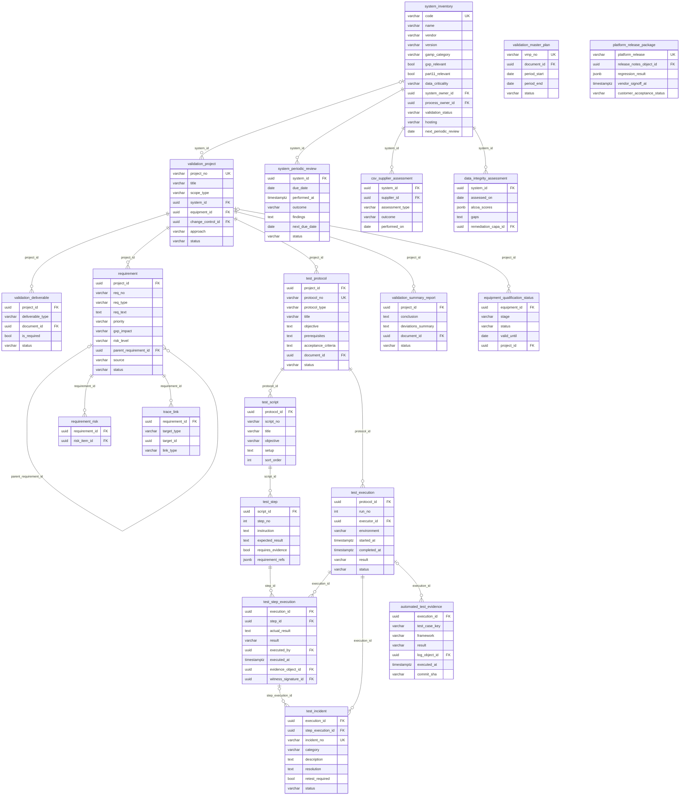

Cross-domain references:

| Entity | Column | References |
|---|---|---|
| validation_project | equipment_id | `eqp.equipment` |
| validation_project | change_control_id | `qms.change_control` |
| validation_project | workflow_instance_id | `wf.process_instance` |
| validation_master_plan | document_id | `dms.document` |
| validation_master_plan | workflow_instance_id | `wf.process_instance` |
| validation_deliverable | document_id | `dms.document` |
| requirement_risk | risk_item_id | `qrm.risk_item` |
| test_protocol | document_id | `dms.document` |
| test_protocol | workflow_instance_id | `wf.process_instance` |
| test_execution | workflow_instance_id | `wf.process_instance` |
| test_step_execution | evidence_object_id | `file.stored_object` |
| test_step_execution | witness_signature_id | `esig.signature` |
| test_incident | workflow_instance_id | `wf.process_instance` |
| validation_summary_report | document_id | `dms.document` |
| validation_summary_report | workflow_instance_id | `wf.process_instance` |
| system_periodic_review | workflow_instance_id | `wf.process_instance` |
| equipment_qualification_status | equipment_id | `eqp.equipment` |
| csv_supplier_assessment | supplier_id | `erp.supplier` |
| platform_release_package | release_notes_object_id | `file.stored_object` |
| automated_test_evidence | log_object_id | `file.stored_object` |
| data_integrity_assessment | remediation_capa_id | `qms.capa` |

## `mdm` — Master data

```mermaid
erDiagram
  uom {
    varchar code UK
    varchar name
    varchar dimension
  }
  uom_conversion {
    uuid from_uom_id FK
    uuid to_uom_id FK
    numeric factor
    uuid material_id FK
  }
  material_type {
    varchar code UK
    varchar name
  }
  storage_condition {
    varchar code UK
    varchar name
    numeric temp_min
    numeric temp_max
    numeric humidity_max
    bool light_protect
  }
  material {
    varchar material_no UK
    varchar name
    uuid material_type_id FK
    uuid base_uom_id FK
    bool is_controlled_substance
    varchar controlled_schedule
    uuid storage_condition_id FK
    int shelf_life_days
    int retest_interval_days
    bool requires_coa
    uuid sampling_plan_id FK
    varchar cas_number
    varchar status
  }
  material_site {
    uuid material_id FK
    uuid site_id FK
    varchar status
    varchar inspection_type
    varchar procurement_type
  }
  material_specification_link {
    uuid material_id FK
    uuid specification_id FK
    varchar usage
    date valid_from
  }
  dosage_form {
    varchar code UK
    varchar name
    varchar route
  }
  product {
    varchar product_code UK
    varchar name
    varchar product_type
    varchar industry_segment
    uuid dosage_form_id FK
    varchar therapeutic_area
    bool is_sterile
    bool is_biologic
    varchar status
  }
  product_strength {
    uuid product_id FK
    varchar strength
    uuid uom_id FK
  }
  sku {
    varchar sku_code UK
    uuid product_id FK
    uuid material_id FK
    varchar pack_size
    uuid market_country_id FK
    varchar gtin
    varchar status
  }
  bill_of_material {
    uuid material_id FK
    varchar bom_no UK
    numeric base_quantity
    uuid base_uom_id FK
    varchar usage
    varchar status
  }
  bom_item {
    uuid bom_id FK
    int line_no
    uuid component_material_id FK
    numeric quantity
    uuid uom_id FK
    bool is_active_ingredient
    numeric overage_pct
    numeric scrap_pct
    varchar phase
  }
  reason_code {
    varchar code UK
    varchar category
    varchar description
  }
  hazard_classification {
    uuid material_id FK
    varchar ghs_class
    uuid sds_document_id FK
  }
  packaging_component {
    uuid material_id FK
    varchar component_type
    uuid artwork_id FK
    jsonb dimensions
  }
  controlled_substance_license {
    uuid material_id FK
    varchar authority
    varchar license_no
    numeric quota
    date valid_to
  }
  data_steward_request {
    varchar entity_type
    uuid entity_id
    varchar request_type
    jsonb payload
    varchar status
  }
  market {
    varchar code UK
    varchar name
    uuid country_id FK
  }
  currency {
    varchar code UK
    varchar name
    int decimals
  }
  exchange_rate {
    uuid from_currency_id FK
    uuid to_currency_id FK
    numeric rate
    date valid_on
  }
  uom ||--o{ uom_conversion : "from_uom_id"
  uom ||--o{ uom_conversion : "to_uom_id"
  material |o--o{ uom_conversion : "material_id"
  material_type ||--o{ material : "material_type_id"
  uom ||--o{ material : "base_uom_id"
  storage_condition |o--o{ material : "storage_condition_id"
  material ||--o{ material_site : "material_id"
  material ||--o{ material_specification_link : "material_id"
  dosage_form |o--o{ product : "dosage_form_id"
  product ||--o{ product_strength : "product_id"
  uom |o--o{ product_strength : "uom_id"
  product ||--o{ sku : "product_id"
  material ||--o{ sku : "material_id"
  material ||--o{ bill_of_material : "material_id"
  uom ||--o{ bill_of_material : "base_uom_id"
  bill_of_material ||--o{ bom_item : "bom_id"
  material ||--o{ bom_item : "component_material_id"
  uom ||--o{ bom_item : "uom_id"
  material ||--o{ hazard_classification : "material_id"
  material ||--o{ packaging_component : "material_id"
  material ||--o{ controlled_substance_license : "material_id"
  currency ||--o{ exchange_rate : "from_currency_id"
  currency ||--o{ exchange_rate : "to_currency_id"
```

Cross-domain references:

| Entity | Column | References |
|---|---|---|
| material | sampling_plan_id | `lims.sampling_plan` |
| material_specification_link | specification_id | `lims.specification` |
| sku | market_country_id | `org.country` |
| hazard_classification | sds_document_id | `dms.document` |
| packaging_component | artwork_id | `rim.artwork` |
| data_steward_request | workflow_instance_id | `wf.process_instance` |
| market | country_id | `org.country` |

## `erp` — Pharmaceutical ERP (procure-to-pay, plan, order-to-cash handoff)

```mermaid
erDiagram
  supplier {
    varchar supplier_no UK
    varchar name
    uuid country_id FK
    varchar tax_id
    varchar status
    varchar payment_terms
    uuid currency_id FK
    bool is_manufacturer
    bool is_distributor
  }
  supplier_contact {
    uuid supplier_id FK
    varchar name
    varchar email
    varchar phone
    varchar contact_role
  }
  customer {
    varchar customer_no UK
    varchar name
    uuid country_id FK
    varchar customer_type
    varchar license_no
    date license_expiry
    varchar status
  }
  customer_site {
    uuid customer_id FK
    varchar name
    jsonb address
    bool ship_to
    bool gdp_qualified
  }
  purchase_requisition {
    varchar pr_no UK
    uuid requested_by FK
    varchar status
    date need_by
  }
  purchase_requisition_line {
    uuid pr_id FK
    int line_no
    uuid material_id FK
    numeric quantity
    uuid uom_id FK
  }
  purchase_order {
    varchar po_no UK
    uuid supplier_id FK
    date order_date
    uuid currency_id FK
    varchar status
    money total_amount
  }
  purchase_order_line {
    uuid po_id FK
    int line_no
    uuid material_id FK
    numeric quantity
    uuid uom_id FK
    money unit_price
    date delivery_date
    uuid manufacturer_site_id FK
    varchar asl_check_status
  }
  sales_order {
    varchar so_no UK
    uuid customer_id FK
    date order_date
    varchar status
  }
  sales_order_line {
    uuid so_id FK
    int line_no
    uuid sku_id FK
    numeric quantity
    uuid uom_id FK
    date requested_date
  }
  demand_forecast {
    uuid sku_id FK
    uuid site_id FK
    date period_start
    numeric quantity
    varchar forecast_version
  }
  master_production_schedule {
    varchar mps_no UK
    date period_start
    date period_end
    varchar status
  }
  mps_line {
    uuid mps_id FK
    uuid material_id FK
    numeric planned_quantity
    date week_start
  }
  mrp_run {
    timestamptz run_at
    int horizon_days
    jsonb parameters
    varchar status
  }
  planned_order {
    uuid mrp_run_id FK
    uuid material_id FK
    numeric quantity
    date due_date
    varchar order_type
    uuid converted_ref
  }
  production_order {
    varchar order_no UK
    uuid material_id FK
    uuid master_recipe_id FK
    varchar master_recipe_version
    numeric planned_quantity
    uuid uom_id FK
    timestamptz planned_start
    timestamptz planned_end
    varchar status
  }
  production_order_component {
    uuid production_order_id FK
    uuid material_id FK
    numeric required_quantity
    uuid uom_id FK
    numeric reserved_quantity
  }
  cost_record {
    uuid production_order_id FK
    uuid cost_center_id FK
    varchar cost_element
    money amount
    uuid currency_id FK
    date posted_on
  }
  finance_posting_outbox {
    varchar source_type
    uuid source_id
    jsonb payload
    varchar status
    timestamptz posted_at
  }
  price_list {
    varchar code UK
    uuid currency_id FK
    date valid_from
  }
  price_list_item {
    uuid price_list_id FK
    uuid sku_id FK
    money price
  }
  delivery {
    varchar delivery_no UK
    uuid sales_order_id FK
    date ship_date
    varchar carrier
    varchar status
  }
  delivery_line {
    uuid delivery_id FK
    uuid so_line_id FK
    uuid lot_id FK
    numeric quantity
  }
  return_authorization {
    varchar rma_no UK
    uuid customer_id FK
    varchar reason
    uuid complaint_id FK
    varchar status
  }
  return_line {
    uuid rma_id FK
    uuid sku_id FK
    uuid lot_id FK
    numeric quantity
    varchar disposition
  }
  supplier ||--o{ supplier_contact : "supplier_id"
  customer ||--o{ customer_site : "customer_id"
  purchase_requisition ||--o{ purchase_requisition_line : "pr_id"
  supplier ||--o{ purchase_order : "supplier_id"
  purchase_order ||--o{ purchase_order_line : "po_id"
  customer ||--o{ sales_order : "customer_id"
  sales_order ||--o{ sales_order_line : "so_id"
  master_production_schedule ||--o{ mps_line : "mps_id"
  mrp_run |o--o{ planned_order : "mrp_run_id"
  production_order ||--o{ production_order_component : "production_order_id"
  production_order |o--o{ cost_record : "production_order_id"
  price_list ||--o{ price_list_item : "price_list_id"
  sales_order ||--o{ delivery : "sales_order_id"
  delivery ||--o{ delivery_line : "delivery_id"
  sales_order_line ||--o{ delivery_line : "so_line_id"
  customer ||--o{ return_authorization : "customer_id"
  return_authorization ||--o{ return_line : "rma_id"
```

Cross-domain references:

| Entity | Column | References |
|---|---|---|
| supplier | country_id | `org.country` |
| supplier | currency_id | `mdm.currency` |
| customer | country_id | `org.country` |
| purchase_requisition | workflow_instance_id | `wf.process_instance` |
| purchase_requisition_line | material_id | `mdm.material` |
| purchase_requisition_line | uom_id | `mdm.uom` |
| purchase_order | currency_id | `mdm.currency` |
| purchase_order | workflow_instance_id | `wf.process_instance` |
| purchase_order_line | material_id | `mdm.material` |
| purchase_order_line | uom_id | `mdm.uom` |
| purchase_order_line | manufacturer_site_id | `sqm.supplier_site` |
| sales_order_line | sku_id | `mdm.sku` |
| sales_order_line | uom_id | `mdm.uom` |
| demand_forecast | sku_id | `mdm.sku` |
| mps_line | material_id | `mdm.material` |
| planned_order | material_id | `mdm.material` |
| production_order | material_id | `mdm.material` |
| production_order | master_recipe_id | `mes.master_recipe` |
| production_order | uom_id | `mdm.uom` |
| production_order | workflow_instance_id | `wf.process_instance` |
| production_order_component | material_id | `mdm.material` |
| production_order_component | uom_id | `mdm.uom` |
| cost_record | cost_center_id | `org.cost_center` |
| cost_record | currency_id | `mdm.currency` |
| price_list | currency_id | `mdm.currency` |
| price_list_item | sku_id | `mdm.sku` |
| delivery_line | lot_id | `wms.lot` |
| return_authorization | complaint_id | `qms.complaint` |
| return_authorization | workflow_instance_id | `wf.process_instance` |
| return_line | sku_id | `mdm.sku` |
| return_line | lot_id | `wms.lot` |

## `mes` — Manufacturing execution (ISA-88 recipes, EBR)

```mermaid
erDiagram
  master_recipe {
    varchar recipe_no UK
    uuid material_id FK
    varchar name
    varchar recipe_type
    numeric batch_size
    uuid uom_id FK
    uuid bom_id FK
    numeric theoretical_yield
    numeric yield_lower_limit
    numeric yield_upper_limit
    varchar status
    date effective_from
  }
  master_formula {
    uuid recipe_id FK
    uuid document_id FK
    jsonb formula_json
  }
  recipe_procedure {
    uuid recipe_id FK
    varchar code
    varchar name
    int sort_order
  }
  recipe_unit_procedure {
    uuid procedure_id FK
    varchar code
    varchar name
    uuid equipment_class_id FK
    int sort_order
  }
  recipe_operation {
    uuid unit_procedure_id FK
    varchar code
    varchar name
    varchar room_class
    int sort_order
  }
  recipe_phase {
    uuid operation_id FK
    varchar code
    varchar name
    varchar phase_type
    text instruction
    jsonb config
    bool is_critical
    bool requires_verification
    int sort_order
  }
  recipe_parameter {
    uuid phase_id FK
    varchar code
    varchar name
    varchar data_type
    numeric target
    numeric lower_limit
    numeric upper_limit
    uuid uom_id FK
    bool is_cpp
    bool alarm_on_violation
  }
  recipe_material_requirement {
    uuid phase_id FK
    uuid material_id FK
    numeric quantity
    uuid uom_id FK
    numeric tolerance_pct
    bool is_scaled
    bool potency_adjusted
  }
  recipe_ipc_definition {
    uuid phase_id FK
    varchar test_code
    varchar frequency
    int sample_size
    numeric lower_limit
    numeric upper_limit
    uuid uom_id FK
  }
  batch {
    varchar batch_no UK
    uuid production_order_id FK
    uuid master_recipe_id FK
    varchar master_recipe_version
    uuid material_id FK
    numeric planned_quantity
    numeric actual_quantity
    uuid uom_id FK
    date manufacture_date
    date expiry_date
    varchar status
    varchar release_status
    timestamptz started_at
    timestamptz completed_at
  }
  batch_record {
    uuid batch_id FK
    varchar record_type
    varchar status
    varchar review_status
    uuid generated_object_id FK
    hash content_hash
  }
  batch_step_execution {
    uuid batch_record_id FK
    uuid phase_id FK
    int sequence_no
    varchar status
    timestamptz started_at
    timestamptz completed_at
    uuid performed_by FK
    uuid verified_by FK
    uuid room_id FK
    uuid equipment_id FK
    jsonb data
    bool has_exception
  }
  batch_parameter_value {
    uuid step_execution_id FK
    uuid parameter_id FK
    numeric value_numeric
    varchar value_text
    timestamptz recorded_at
    uuid recorded_by FK
    varchar source
    bool in_limits
  }
  batch_exception {
    uuid batch_record_id FK
    uuid step_execution_id FK
    varchar exception_type
    text description
    varchar severity
    uuid deviation_id FK
    uuid reviewed_by FK
    timestamptz reviewed_at
    varchar status
  }
  batch_comment {
    uuid batch_record_id FK
    uuid step_execution_id FK
    uuid author_id FK
    text body
  }
  dispensing_order {
    varchar dispense_no UK
    uuid batch_id FK
    uuid booth_room_id FK
    varchar status
  }
  dispensing_line {
    uuid dispensing_order_id FK
    uuid material_id FK
    numeric required_quantity
    uuid uom_id FK
    numeric potency_factor
    varchar status
  }
  weighing_record {
    uuid dispensing_line_id FK
    uuid source_lot_id FK
    uuid container_id FK
    uuid balance_id FK
    numeric tare
    numeric gross
    numeric net
    uuid uom_id FK
    bool in_tolerance
    uuid weighed_by FK
    uuid verified_by FK
    timestamptz weighed_at
    bool label_printed
    uuid balance_check_id FK
  }
  material_charge {
    uuid step_execution_id FK
    uuid weighing_record_id FK
    uuid lot_id FK
    numeric quantity
    uuid uom_id FK
    uuid charged_by FK
    uuid verified_by FK
    timestamptz charged_at
  }
  checklist_template {
    varchar code UK
    varchar name
    jsonb items
  }
  line_clearance {
    uuid batch_id FK
    uuid room_id FK
    uuid equipment_id FK
    varchar clearance_type
    uuid checklist_template_id FK
    varchar previous_batch_no
    uuid performed_by FK
    uuid verified_by FK
    timestamptz performed_at
    varchar result
  }
  checklist_response {
    uuid line_clearance_id FK
    varchar item_code
    varchar response
    varchar comment
  }
  ipc_result {
    uuid batch_id FK
    uuid ipc_definition_id FK
    uuid step_execution_id FK
    timestamptz sample_time
    numeric value
    varchar result_text
    bool in_spec
    uuid performed_by FK
    uuid instrument_id FK
  }
  equipment_usage {
    uuid equipment_id FK
    uuid batch_id FK
    varchar activity
    timestamptz start_at
    timestamptz end_at
    uuid performed_by FK
    varchar status_before
    varchar status_after
  }
  yield_reconciliation {
    uuid batch_id FK
    varchar stage
    numeric theoretical_quantity
    numeric actual_quantity
    numeric samples_quantity
    numeric waste_quantity
    numeric yield_pct
    bool in_limits
    varchar justification
    uuid verified_by FK
  }
  label_reconciliation {
    uuid batch_id FK
    uuid label_material_id FK
    int issued
    int used
    int destroyed
    int returned
    int variance
    bool in_limits
  }
  batch_review {
    uuid batch_id FK
    varchar review_type
    uuid reviewer_id FK
    bool review_by_exception
    varchar outcome
    timestamptz completed_at
    uuid signature_id FK
  }
  batch_release {
    uuid batch_id FK
    varchar release_type
    uuid market_id FK
    varchar decision
    uuid decided_by FK
    timestamptz decided_at
    uuid signature_id FK
    varchar conditions
    jsonb checklist
  }
  batch_release_check {
    uuid batch_release_id FK
    varchar check_code
    varchar check_name
    varchar result
    jsonb evidence_ref
    bool auto_evaluated
  }
  work_center {
    varchar code UK
    varchar name
    uuid room_id FK
  }
  production_schedule_slot {
    uuid work_center_id FK
    uuid batch_id FK
    timestamptz start_at
    timestamptz end_at
    varchar status
  }
  process_data_tag {
    uuid equipment_id FK
    varchar tag_name
    varchar opcua_node_id
    varchar data_type
    uuid uom_id FK
    varchar recipe_parameter_code
  }
  process_data_point {
    uuid tag_id FK
    timestamptz sample_ts
    numeric value
    varchar quality_code
  }
  batch_sample {
    uuid batch_id FK
    uuid lims_sample_id FK
    uuid step_execution_id FK
    varchar sample_point
  }
  batch_document_link {
    uuid batch_id FK
    uuid document_version_id FK
  }
  master_recipe ||--o{ master_formula : "recipe_id"
  master_recipe ||--o{ recipe_procedure : "recipe_id"
  recipe_procedure ||--o{ recipe_unit_procedure : "procedure_id"
  recipe_unit_procedure ||--o{ recipe_operation : "unit_procedure_id"
  recipe_operation ||--o{ recipe_phase : "operation_id"
  recipe_phase ||--o{ recipe_parameter : "phase_id"
  recipe_phase ||--o{ recipe_material_requirement : "phase_id"
  recipe_phase ||--o{ recipe_ipc_definition : "phase_id"
  master_recipe ||--o{ batch : "master_recipe_id"
  batch ||--o{ batch_record : "batch_id"
  batch_record ||--o{ batch_step_execution : "batch_record_id"
  recipe_phase ||--o{ batch_step_execution : "phase_id"
  batch_step_execution ||--o{ batch_parameter_value : "step_execution_id"
  recipe_parameter ||--o{ batch_parameter_value : "parameter_id"
  batch_record ||--o{ batch_exception : "batch_record_id"
  batch_step_execution |o--o{ batch_exception : "step_execution_id"
  batch_record ||--o{ batch_comment : "batch_record_id"
  batch_step_execution |o--o{ batch_comment : "step_execution_id"
  batch ||--o{ dispensing_order : "batch_id"
  dispensing_order ||--o{ dispensing_line : "dispensing_order_id"
  dispensing_line ||--o{ weighing_record : "dispensing_line_id"
  batch_step_execution ||--o{ material_charge : "step_execution_id"
  weighing_record |o--o{ material_charge : "weighing_record_id"
  batch |o--o{ line_clearance : "batch_id"
  checklist_template |o--o{ line_clearance : "checklist_template_id"
  line_clearance ||--o{ checklist_response : "line_clearance_id"
  batch ||--o{ ipc_result : "batch_id"
  recipe_ipc_definition ||--o{ ipc_result : "ipc_definition_id"
  batch_step_execution |o--o{ ipc_result : "step_execution_id"
  batch |o--o{ equipment_usage : "batch_id"
  batch ||--o{ yield_reconciliation : "batch_id"
  batch ||--o{ label_reconciliation : "batch_id"
  batch ||--o{ batch_review : "batch_id"
  batch ||--o{ batch_release : "batch_id"
  batch_release ||--o{ batch_release_check : "batch_release_id"
  work_center ||--o{ production_schedule_slot : "work_center_id"
  batch |o--o{ production_schedule_slot : "batch_id"
  process_data_tag ||--o{ process_data_point : "tag_id"
  batch ||--o{ batch_sample : "batch_id"
  batch_step_execution |o--o{ batch_sample : "step_execution_id"
  batch ||--o{ batch_document_link : "batch_id"
```

Cross-domain references:

| Entity | Column | References |
|---|---|---|
| master_recipe | material_id | `mdm.material` |
| master_recipe | uom_id | `mdm.uom` |
| master_recipe | bom_id | `mdm.bill_of_material` |
| master_recipe | workflow_instance_id | `wf.process_instance` |
| master_formula | document_id | `dms.document` |
| recipe_unit_procedure | equipment_class_id | `eqp.equipment_class` |
| recipe_parameter | uom_id | `mdm.uom` |
| recipe_material_requirement | material_id | `mdm.material` |
| recipe_material_requirement | uom_id | `mdm.uom` |
| recipe_ipc_definition | uom_id | `mdm.uom` |
| batch | production_order_id | `erp.production_order` |
| batch | material_id | `mdm.material` |
| batch | uom_id | `mdm.uom` |
| batch | workflow_instance_id | `wf.process_instance` |
| batch_record | generated_object_id | `file.stored_object` |
| batch_step_execution | room_id | `org.room` |
| batch_step_execution | equipment_id | `eqp.equipment` |
| batch_exception | deviation_id | `qms.deviation` |
| dispensing_order | booth_room_id | `org.room` |
| dispensing_line | material_id | `mdm.material` |
| dispensing_line | uom_id | `mdm.uom` |
| weighing_record | source_lot_id | `wms.lot` |
| weighing_record | container_id | `wms.container` |
| weighing_record | balance_id | `eqp.equipment` |
| weighing_record | uom_id | `mdm.uom` |
| weighing_record | balance_check_id | `eqp.balance_daily_check` |
| material_charge | lot_id | `wms.lot` |
| material_charge | uom_id | `mdm.uom` |
| line_clearance | room_id | `org.room` |
| line_clearance | equipment_id | `eqp.equipment` |
| line_clearance | workflow_instance_id | `wf.process_instance` |
| ipc_result | instrument_id | `eqp.equipment` |
| equipment_usage | equipment_id | `eqp.equipment` |
| label_reconciliation | label_material_id | `mdm.material` |
| batch_review | signature_id | `esig.signature` |
| batch_review | workflow_instance_id | `wf.process_instance` |
| batch_release | market_id | `mdm.market` |
| batch_release | signature_id | `esig.signature` |
| batch_release | workflow_instance_id | `wf.process_instance` |
| work_center | room_id | `org.room` |
| process_data_tag | equipment_id | `eqp.equipment` |
| process_data_tag | uom_id | `mdm.uom` |
| batch_sample | lims_sample_id | `lims.sample` |
| batch_document_link | document_version_id | `dms.document_version` |

## `wms` — Warehouse management & genealogy

```mermaid
erDiagram
  warehouse {
    varchar code UK
    varchar name
    varchar warehouse_type
    varchar temperature_zone
  }
  storage_zone {
    uuid warehouse_id FK
    varchar code
    varchar zone_type
    uuid storage_condition_id FK
  }
  storage_location {
    uuid zone_id FK
    varchar code
    varchar barcode UK
    numeric capacity
    bool is_blocked
  }
  lot {
    varchar lot_no UK
    uuid material_id FK
    varchar supplier_lot_no
    varchar manufacturer_lot_no
    uuid supplier_id FK
    uuid manufacturer_site_id FK
    uuid batch_id FK
    date manufacture_date
    date expiry_date
    date retest_date
    varchar quality_status
    numeric potency
    varchar status
  }
  lot_status_history {
    uuid lot_id FK
    varchar from_status
    varchar to_status
    timestamptz changed_at
    uuid changed_by FK
    varchar reason
    uuid signature_id FK
  }
  container {
    varchar container_no UK
    uuid lot_id FK
    varchar container_type
    numeric quantity
    uuid uom_id FK
    uuid location_id FK
    varchar status
    bool is_sampled
    numeric tare
    varchar label_barcode
  }
  handling_unit {
    varchar hu_no UK
    varchar hu_type
    uuid parent_hu_id FK
    uuid location_id FK
    varchar sscc
  }
  handling_unit_content {
    uuid hu_id FK
    uuid container_id FK
    uuid lot_id FK
    numeric quantity
  }
  inventory_balance {
    uuid material_id FK
    uuid lot_id FK
    uuid location_id FK
    numeric quantity
    uuid uom_id FK
    varchar quality_status
    numeric reserved_quantity
  }
  inventory_transaction {
    varchar txn_no UK
    varchar txn_type
    uuid material_id FK
    uuid lot_id FK
    uuid container_id FK
    uuid from_location_id FK
    uuid to_location_id FK
    numeric quantity
    uuid uom_id FK
    varchar reference_type
    uuid reference_id
    uuid reason_code_id FK
    uuid performed_by FK
    timestamptz performed_at
  }
  goods_receipt {
    varchar gr_no UK
    uuid po_id FK
    uuid supplier_id FK
    timestamptz received_at
    varchar delivery_note
    bool temperature_ok
    bool seal_intact
    varchar status
  }
  goods_receipt_line {
    uuid gr_id FK
    uuid po_line_id FK
    uuid material_id FK
    uuid lot_id FK
    numeric quantity
    uuid uom_id FK
    int containers
    bool asl_verified
    bool coa_received
  }
  reservation {
    uuid material_id FK
    uuid lot_id FK
    numeric quantity
    varchar reference_type
    uuid reference_id
    varchar status
  }
  picking_rule {
    varchar code UK
    varchar strategy
    uuid material_type_id FK
    int min_remaining_shelf_life_days
  }
  pick_list {
    varchar pick_no UK
    varchar reference_type
    uuid reference_id
    varchar strategy
    varchar status
  }
  pick_list_line {
    uuid pick_list_id FK
    uuid material_id FK
    uuid lot_id FK
    uuid container_id FK
    uuid location_id FK
    numeric quantity
    numeric picked_quantity
    uuid picked_by FK
    timestamptz picked_at
    varchar override_reason
  }
  transfer_order {
    varchar to_no UK
    uuid from_warehouse_id FK
    uuid to_warehouse_id FK
    varchar status
  }
  transfer_order_line {
    uuid transfer_order_id FK
    uuid lot_id FK
    numeric quantity
    uuid uom_id FK
  }
  cycle_count_plan {
    varchar code UK
    varchar name
    varchar method
    varchar frequency
  }
  cycle_count {
    varchar count_no UK
    uuid plan_id FK
    uuid warehouse_id FK
    date scheduled_date
    bool blind_count
    varchar status
  }
  cycle_count_line {
    uuid cycle_count_id FK
    uuid location_id FK
    uuid lot_id FK
    numeric system_quantity
    numeric counted_quantity
    numeric variance
    bool recount_required
    uuid counted_by FK
    uuid adjustment_txn_id FK
  }
  stock_reconciliation {
    varchar recon_no UK
    date period_end
    varchar scope
    varchar status
    money variance_value
  }
  stock_reconciliation_line {
    uuid recon_id FK
    uuid material_id FK
    uuid lot_id FK
    numeric book_quantity
    numeric physical_quantity
    numeric variance
    varchar explanation
  }
  genealogy_link {
    uuid parent_lot_id FK
    uuid child_lot_id FK
    uuid batch_id FK
    numeric quantity
    varchar relation
  }
  label_template {
    varchar code UK
    varchar name
    varchar label_type
    varchar format
    text template
    varchar barcode_symbology
  }
  label_print_job {
    uuid template_id FK
    varchar printer_code
    varchar reference_type
    uuid reference_id
    int copies
    uuid printed_by FK
    timestamptz printed_at
    varchar reprint_reason
  }
  serial_number {
    uuid sku_id FK
    uuid lot_id FK
    varchar serial_no
    varchar status
    uuid aggregated_hu_id FK
  }
  temperature_excursion {
    uuid location_id FK
    uuid lot_id FK
    varchar shipment_ref
    numeric min_recorded
    numeric max_recorded
    interval duration
    timestamptz detected_at
    varchar assessment
    uuid deviation_id FK
  }
  material_return_to_stock {
    uuid batch_id FK
    uuid lot_id FK
    numeric quantity
    uuid verified_by FK
    varchar status
  }
  destruction_record {
    uuid lot_id FK
    numeric quantity
    varchar method
    uuid witnessed_by FK
    timestamptz destroyed_at
    uuid certificate_object_id FK
  }
  warehouse ||--o{ storage_zone : "warehouse_id"
  storage_zone ||--o{ storage_location : "zone_id"
  lot ||--o{ lot_status_history : "lot_id"
  lot ||--o{ container : "lot_id"
  storage_location |o--o{ container : "location_id"
  handling_unit |o--o{ handling_unit : "parent_hu_id"
  storage_location |o--o{ handling_unit : "location_id"
  handling_unit ||--o{ handling_unit_content : "hu_id"
  container |o--o{ handling_unit_content : "container_id"
  lot |o--o{ handling_unit_content : "lot_id"
  lot ||--o{ inventory_balance : "lot_id"
  storage_location ||--o{ inventory_balance : "location_id"
  lot |o--o{ inventory_transaction : "lot_id"
  container |o--o{ inventory_transaction : "container_id"
  storage_location |o--o{ inventory_transaction : "from_location_id"
  storage_location |o--o{ inventory_transaction : "to_location_id"
  goods_receipt ||--o{ goods_receipt_line : "gr_id"
  lot ||--o{ goods_receipt_line : "lot_id"
  lot |o--o{ reservation : "lot_id"
  pick_list ||--o{ pick_list_line : "pick_list_id"
  lot |o--o{ pick_list_line : "lot_id"
  container |o--o{ pick_list_line : "container_id"
  storage_location |o--o{ pick_list_line : "location_id"
  warehouse ||--o{ transfer_order : "from_warehouse_id"
  warehouse ||--o{ transfer_order : "to_warehouse_id"
  transfer_order ||--o{ transfer_order_line : "transfer_order_id"
  lot ||--o{ transfer_order_line : "lot_id"
  cycle_count_plan |o--o{ cycle_count : "plan_id"
  warehouse ||--o{ cycle_count : "warehouse_id"
  cycle_count ||--o{ cycle_count_line : "cycle_count_id"
  storage_location ||--o{ cycle_count_line : "location_id"
  lot |o--o{ cycle_count_line : "lot_id"
  inventory_transaction |o--o{ cycle_count_line : "adjustment_txn_id"
  stock_reconciliation ||--o{ stock_reconciliation_line : "recon_id"
  lot |o--o{ stock_reconciliation_line : "lot_id"
  lot ||--o{ genealogy_link : "parent_lot_id"
  lot ||--o{ genealogy_link : "child_lot_id"
  label_template ||--o{ label_print_job : "template_id"
  lot ||--o{ serial_number : "lot_id"
  handling_unit |o--o{ serial_number : "aggregated_hu_id"
  storage_location |o--o{ temperature_excursion : "location_id"
  lot |o--o{ temperature_excursion : "lot_id"
  lot ||--o{ material_return_to_stock : "lot_id"
  lot ||--o{ destruction_record : "lot_id"
```

Cross-domain references:

| Entity | Column | References |
|---|---|---|
| storage_zone | storage_condition_id | `mdm.storage_condition` |
| lot | material_id | `mdm.material` |
| lot | supplier_id | `erp.supplier` |
| lot | manufacturer_site_id | `sqm.supplier_site` |
| lot | batch_id | `mes.batch` |
| lot_status_history | signature_id | `esig.signature` |
| container | uom_id | `mdm.uom` |
| inventory_balance | material_id | `mdm.material` |
| inventory_balance | uom_id | `mdm.uom` |
| inventory_transaction | material_id | `mdm.material` |
| inventory_transaction | uom_id | `mdm.uom` |
| inventory_transaction | reason_code_id | `mdm.reason_code` |
| goods_receipt | po_id | `erp.purchase_order` |
| goods_receipt | supplier_id | `erp.supplier` |
| goods_receipt | workflow_instance_id | `wf.process_instance` |
| goods_receipt_line | po_line_id | `erp.purchase_order_line` |
| goods_receipt_line | material_id | `mdm.material` |
| goods_receipt_line | uom_id | `mdm.uom` |
| reservation | material_id | `mdm.material` |
| picking_rule | material_type_id | `mdm.material_type` |
| pick_list_line | material_id | `mdm.material` |
| transfer_order_line | uom_id | `mdm.uom` |
| cycle_count | workflow_instance_id | `wf.process_instance` |
| stock_reconciliation | workflow_instance_id | `wf.process_instance` |
| stock_reconciliation_line | material_id | `mdm.material` |
| genealogy_link | batch_id | `mes.batch` |
| serial_number | sku_id | `mdm.sku` |
| temperature_excursion | deviation_id | `qms.deviation` |
| temperature_excursion | workflow_instance_id | `wf.process_instance` |
| material_return_to_stock | batch_id | `mes.batch` |
| destruction_record | certificate_object_id | `file.stored_object` |
| destruction_record | workflow_instance_id | `wf.process_instance` |

## `lims` — Laboratory information management

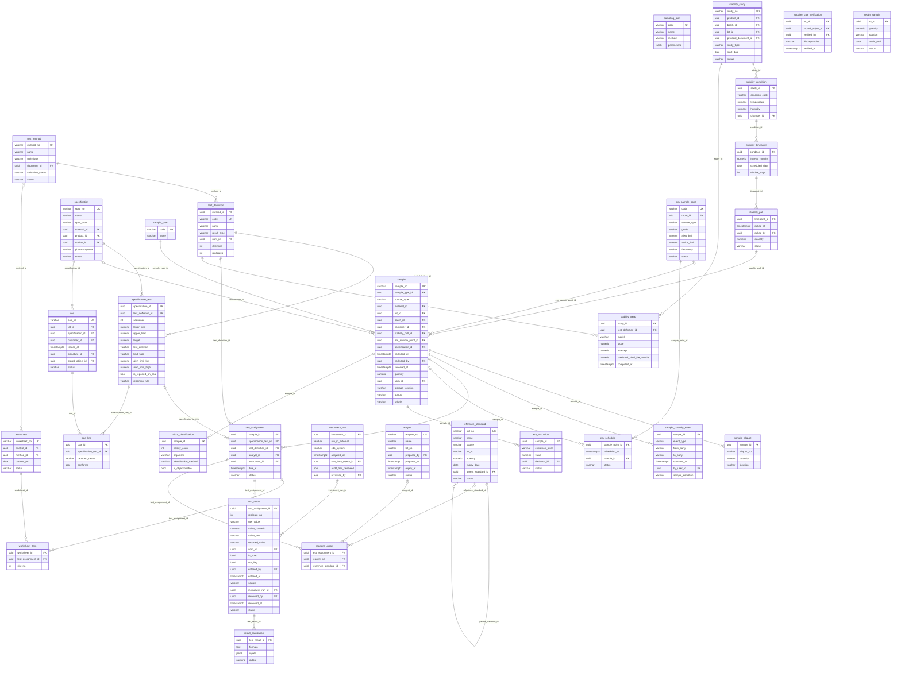

Cross-domain references:

| Entity | Column | References |
|---|---|---|
| test_method | document_id | `dms.document` |
| test_method | workflow_instance_id | `wf.process_instance` |
| test_definition | uom_id | `mdm.uom` |
| specification | material_id | `mdm.material` |
| specification | product_id | `mdm.product` |
| specification | market_id | `mdm.market` |
| specification | workflow_instance_id | `wf.process_instance` |
| sample | material_id | `mdm.material` |
| sample | lot_id | `wms.lot` |
| sample | batch_id | `mes.batch` |
| sample | container_id | `wms.container` |
| sample | uom_id | `mdm.uom` |
| sample | workflow_instance_id | `wf.process_instance` |
| test_assignment | instrument_id | `eqp.equipment` |
| instrument_run | instrument_id | `eqp.equipment` |
| instrument_run | raw_data_object_id | `file.stored_object` |
| test_result | uom_id | `mdm.uom` |
| stability_study | product_id | `mdm.product` |
| stability_study | batch_id | `mes.batch` |
| stability_study | lot_id | `wms.lot` |
| stability_study | protocol_document_id | `dms.document` |
| stability_study | workflow_instance_id | `wf.process_instance` |
| stability_condition | chamber_id | `eqp.equipment` |
| em_sample_point | room_id | `org.room` |
| em_excursion | deviation_id | `qms.deviation` |
| em_excursion | workflow_instance_id | `wf.process_instance` |
| coa | lot_id | `wms.lot` |
| coa | customer_id | `erp.customer` |
| coa | signature_id | `esig.signature` |
| coa | stored_object_id | `file.stored_object` |
| coa | workflow_instance_id | `wf.process_instance` |
| supplier_coa_verification | lot_id | `wms.lot` |
| supplier_coa_verification | stored_object_id | `file.stored_object` |
| retain_sample | lot_id | `wms.lot` |

## `eqp` — Equipment, calibration, maintenance, utilities

```mermaid
erDiagram
  equipment_class {
    varchar code UK
    varchar name
    varchar isa88_level
  }
  equipment {
    varchar equipment_no UK
    varchar name
    uuid equipment_class_id FK
    uuid room_id FK
    varchar manufacturer
    varchar model
    varchar serial_no
    bool gxp_critical
    varchar status
    varchar qualification_status
    date calibration_due
    date pm_due
    timestamptz cleaning_hold_until
  }
  equipment_component {
    uuid equipment_id FK
    varchar name
    varchar part_no
    bool is_product_contact
  }
  equipment_status_history {
    uuid equipment_id FK
    varchar from_status
    varchar to_status
    timestamptz changed_at
    uuid changed_by FK
    varchar reason
  }
  calibration_plan {
    uuid equipment_id FK
    int frequency_days
    uuid procedure_document_id FK
    jsonb tolerance
  }
  calibration_record {
    uuid equipment_id FK
    uuid plan_id FK
    timestamptz performed_at
    uuid performed_by FK
    varchar vendor
    jsonb as_found
    jsonb as_left
    varchar result
    uuid certificate_object_id FK
    date next_due
  }
  balance_daily_check {
    uuid equipment_id FK
    timestamptz checked_at
    jsonb weights_used
    jsonb results
    bool passed
    uuid checked_by FK
  }
  maintenance_plan {
    uuid equipment_id FK
    varchar plan_type
    int frequency_days
    jsonb tasks
  }
  work_order {
    varchar wo_no UK
    uuid equipment_id FK
    varchar wo_type
    text description
    date scheduled_date
    timestamptz completed_at
    varchar impact_on_qualification
    uuid change_control_id FK
    varchar status
  }
  work_order_task {
    uuid work_order_id FK
    int task_no
    varchar description
    bool done
    uuid done_by FK
  }
  spare_part {
    varchar part_no UK
    varchar name
    uuid material_id FK
  }
  cleaning_procedure {
    varchar code UK
    uuid equipment_class_id FK
    uuid document_id FK
    int dirty_hold_hours
    int clean_hold_hours
  }
  cleaning_record {
    uuid equipment_id FK
    uuid procedure_id FK
    varchar cleaning_type
    timestamptz started_at
    timestamptz completed_at
    uuid performed_by FK
    uuid verified_by FK
    uuid previous_product_id FK
    uuid swab_sample_id FK
    varchar result
  }
  instrument_interface {
    uuid equipment_id FK
    varchar interface_type
    jsonb connection
    varchar firmware_version
  }
  utility_system {
    varchar code UK
    varchar name
    varchar utility_type
  }
  alarm_event {
    uuid equipment_id FK
    uuid utility_system_id FK
    varchar alarm_code
    varchar severity
    timestamptz raised_at
    uuid acknowledged_by FK
    timestamptz acknowledged_at
    timestamptz cleared_at
  }
  equipment_class ||--o{ equipment : "equipment_class_id"
  equipment ||--o{ equipment_component : "equipment_id"
  equipment ||--o{ equipment_status_history : "equipment_id"
  equipment ||--o{ calibration_plan : "equipment_id"
  equipment ||--o{ calibration_record : "equipment_id"
  calibration_plan |o--o{ calibration_record : "plan_id"
  equipment ||--o{ balance_daily_check : "equipment_id"
  equipment ||--o{ maintenance_plan : "equipment_id"
  equipment ||--o{ work_order : "equipment_id"
  work_order ||--o{ work_order_task : "work_order_id"
  equipment_class |o--o{ cleaning_procedure : "equipment_class_id"
  equipment ||--o{ cleaning_record : "equipment_id"
  cleaning_procedure ||--o{ cleaning_record : "procedure_id"
  equipment ||--o{ instrument_interface : "equipment_id"
  equipment |o--o{ alarm_event : "equipment_id"
  utility_system |o--o{ alarm_event : "utility_system_id"
```

Cross-domain references:

| Entity | Column | References |
|---|---|---|
| equipment | room_id | `org.room` |
| calibration_plan | procedure_document_id | `dms.document` |
| calibration_record | certificate_object_id | `file.stored_object` |
| calibration_record | workflow_instance_id | `wf.process_instance` |
| work_order | change_control_id | `qms.change_control` |
| work_order | workflow_instance_id | `wf.process_instance` |
| spare_part | material_id | `mdm.material` |
| cleaning_procedure | document_id | `dms.document` |
| cleaning_record | previous_product_id | `mdm.product` |
| cleaning_record | swab_sample_id | `lims.sample` |

## `rim` — Regulatory information management

```mermaid
erDiagram
  health_authority {
    varchar code UK
    varchar name
    uuid country_id FK
    varchar region_scope
  }
  product_family {
    varchar code UK
    varchar name
    uuid product_id FK
  }
  marketing_authorization {
    varchar ma_no UK
    uuid product_id FK
    uuid country_id FK
    uuid health_authority_id FK
    uuid holder_legal_entity_id FK
    varchar procedure_type
    date approval_date
    date expiry_date
    date renewal_due
    varchar status
  }
  registered_detail {
    uuid ma_id FK
    varchar detail_type
    text value
    date effective_from
  }
  registered_site {
    uuid ma_id FK
    uuid site_id FK
    uuid supplier_site_id FK
    varchar site_role
  }
  submission {
    varchar submission_no UK
    uuid ma_id FK
    uuid health_authority_id FK
    varchar submission_type
    varchar sequence_no
    varchar format
    date planned_date
    date submitted_date
    date ack_date
    date approval_date
    varchar status
  }
  submission_document {
    uuid submission_id FK
    varchar ctd_section
    uuid document_version_id FK
    uuid stored_object_id FK
  }
  authority_question {
    uuid submission_id FK
    timestamptz received_at
    text question
    date response_due
    text response
    timestamptz responded_at
    varchar status
  }
  variation {
    varchar variation_no UK
    uuid ma_id FK
    uuid change_control_id FK
    varchar category
    text description
    uuid submission_id FK
    date implementation_deadline
    varchar status
  }
  regulatory_commitment {
    varchar commitment_no UK
    varchar source_type
    uuid source_id
    uuid ma_id FK
    text description
    date due_date
    uuid owner_id FK
    varchar status
  }
  artwork {
    varchar artwork_no UK
    uuid sku_id FK
    varchar component_type
    uuid country_id FK
    uuid stored_object_id FK
    varchar status
  }
  artwork_text_element {
    uuid artwork_id FK
    varchar element_code
    text element_text
    varchar locale
    varchar source_ref
  }
  artwork_proof_review {
    uuid artwork_id FK
    uuid reviewer_id FK
    varchar review_type
    varchar outcome
    text comments
    uuid signature_id FK
  }
  label_content {
    varchar label_no UK
    uuid product_id FK
    uuid country_id FK
    varchar label_type
    uuid document_id FK
    varchar status
  }
  label_content_change {
    uuid label_content_id FK
    varchar trigger_type
    text description
    uuid change_control_id FK
    date implementation_due
  }
  market_launch {
    uuid sku_id FK
    uuid country_id FK
    uuid ma_id FK
    date launch_date
    varchar status
  }
  renewal {
    uuid ma_id FK
    date due_date
    uuid submission_id FK
    varchar status
  }
  regulatory_intelligence {
    uuid country_id FK
    varchar title
    text summary
    date effective_date
    text impact_assessment
    varchar status
  }
  idmp_substance {
    varchar code UK
    varchar name
    varchar unii
    uuid material_id FK
  }
  idmp_medicinal_product {
    uuid product_id FK
    varchar mpid
    jsonb pharmaceutical_product
  }
  health_authority ||--o{ marketing_authorization : "health_authority_id"
  marketing_authorization ||--o{ registered_detail : "ma_id"
  marketing_authorization ||--o{ registered_site : "ma_id"
  marketing_authorization |o--o{ submission : "ma_id"
  health_authority ||--o{ submission : "health_authority_id"
  submission ||--o{ submission_document : "submission_id"
  submission ||--o{ authority_question : "submission_id"
  marketing_authorization ||--o{ variation : "ma_id"
  submission |o--o{ variation : "submission_id"
  marketing_authorization |o--o{ regulatory_commitment : "ma_id"
  artwork ||--o{ artwork_text_element : "artwork_id"
  artwork ||--o{ artwork_proof_review : "artwork_id"
  label_content ||--o{ label_content_change : "label_content_id"
  marketing_authorization |o--o{ market_launch : "ma_id"
  marketing_authorization ||--o{ renewal : "ma_id"
  submission |o--o{ renewal : "submission_id"
```

Cross-domain references:

| Entity | Column | References |
|---|---|---|
| health_authority | country_id | `org.country` |
| product_family | product_id | `mdm.product` |
| marketing_authorization | product_id | `mdm.product` |
| marketing_authorization | country_id | `org.country` |
| marketing_authorization | holder_legal_entity_id | `org.legal_entity` |
| marketing_authorization | workflow_instance_id | `wf.process_instance` |
| registered_site | supplier_site_id | `sqm.supplier_site` |
| submission | workflow_instance_id | `wf.process_instance` |
| submission_document | document_version_id | `dms.document_version` |
| submission_document | stored_object_id | `file.stored_object` |
| variation | change_control_id | `qms.change_control` |
| variation | workflow_instance_id | `wf.process_instance` |
| regulatory_commitment | workflow_instance_id | `wf.process_instance` |
| artwork | sku_id | `mdm.sku` |
| artwork | country_id | `org.country` |
| artwork | stored_object_id | `file.stored_object` |
| artwork | workflow_instance_id | `wf.process_instance` |
| artwork_proof_review | signature_id | `esig.signature` |
| label_content | product_id | `mdm.product` |
| label_content | country_id | `org.country` |
| label_content | document_id | `dms.document` |
| label_content | workflow_instance_id | `wf.process_instance` |
| label_content_change | change_control_id | `qms.change_control` |
| market_launch | sku_id | `mdm.sku` |
| market_launch | country_id | `org.country` |
| regulatory_intelligence | country_id | `org.country` |
| idmp_substance | material_id | `mdm.material` |
| idmp_medicinal_product | product_id | `mdm.product` |

## `rpt` — Dashboards, reports, analytics

```mermaid
erDiagram
  data_source {
    varchar code UK
    varchar name
    varchar source_type
    jsonb definition
  }
  dashboard_definition {
    varchar code UK
    varchar name
    varchar audience
    jsonb layout
    bool is_gxp
  }
  dashboard_widget {
    uuid dashboard_id FK
    varchar widget_type
    uuid data_source_id FK
    jsonb config
    jsonb grid_position
  }
  report_definition {
    varchar code UK
    varchar name
    varchar report_type
    varchar engine
    uuid template_id FK
    uuid data_source_id FK
    jsonb parameters
    bool is_validated
  }
  report_schedule {
    uuid report_definition_id FK
    varchar cron
    jsonb recipients
    varchar format
    bool is_active
  }
  report_execution {
    uuid report_definition_id FK
    varchar report_version
    jsonb parameters
    uuid executed_by FK
    timestamptz executed_at
    uuid output_object_id FK
    hash output_hash
    int row_count
  }
  kpi_snapshot {
    varchar metric_code
    uuid org_node_id FK
    date period
    numeric value
  }
  bi_dashboard_binding {
    varchar engine
    varchar external_dashboard_id
    uuid report_definition_id FK
    varchar dataset_ref
    varchar row_filter_role
  }
  user_dashboard_preference {
    uuid user_id FK
    uuid dashboard_id FK
    jsonb overrides
  }
  saved_search {
    uuid user_id FK
    varchar name
    uuid entity_definition_id FK
    jsonb query
    bool is_shared
  }
  dashboard_definition ||--o{ dashboard_widget : "dashboard_id"
  data_source ||--o{ dashboard_widget : "data_source_id"
  data_source |o--o{ report_definition : "data_source_id"
  report_definition ||--o{ report_schedule : "report_definition_id"
  report_definition ||--o{ report_execution : "report_definition_id"
  report_definition |o--o{ bi_dashboard_binding : "report_definition_id"
  dashboard_definition ||--o{ user_dashboard_preference : "dashboard_id"
```

Cross-domain references:

| Entity | Column | References |
|---|---|---|
| report_definition | template_id | `meta.document_template` |
| report_definition | workflow_instance_id | `wf.process_instance` |
| report_execution | output_object_id | `file.stored_object` |
| kpi_snapshot | org_node_id | `org.org_node` |
| saved_search | entity_definition_id | `meta.entity_definition` |

## `intg` — Integration, messaging, migration

```mermaid
erDiagram
  outbox_message {
    varchar aggregate_type
    uuid aggregate_id
    varchar event_type
    jsonb payload
    timestamptz occurred_at
    timestamptz published_at
    int attempts
  }
  inbox_message {
    varchar message_id UK
    varchar source
    varchar event_type
    jsonb payload
    timestamptz received_at
    timestamptz processed_at
    varchar status
  }
  external_system {
    varchar code UK
    varchar name
    varchar system_type
    varchar base_url
    varchar auth_config_ref
    varchar status
  }
  data_mapping {
    varchar code UK
    jsonb source_schema
    jsonb target_schema
    text transform
  }
  integration_endpoint {
    uuid external_system_id FK
    varchar code
    varchar direction
    varchar protocol
    uuid mapping_id FK
    varchar status
  }
  integration_run {
    uuid endpoint_id FK
    timestamptz started_at
    timestamptz ended_at
    int records_in
    int records_out
    int errors
    varchar status
  }
  integration_error {
    uuid run_id FK
    varchar record_ref
    text error
    jsonb payload
    bool resolved
  }
  webhook_subscription {
    varchar url
    jsonb event_types
    varchar secret_ref
    bool is_active
  }
  idempotency_key {
    varchar idem_key UK
    hash request_hash
    jsonb response
    timestamptz expires_at
  }
  migration_batch {
    varchar source_system
    varchar entity_type
    int batch_no
    int records
    hash checksum_source
    hash checksum_target
    varchar status
    uuid verified_by FK
  }
  migration_record_map {
    uuid migration_batch_id FK
    varchar legacy_id
    uuid new_id
    varchar status
  }
  external_system ||--o{ integration_endpoint : "external_system_id"
  data_mapping |o--o{ integration_endpoint : "mapping_id"
  integration_endpoint ||--o{ integration_run : "endpoint_id"
  integration_run ||--o{ integration_error : "run_id"
  migration_batch ||--o{ migration_record_map : "migration_batch_id"
```
